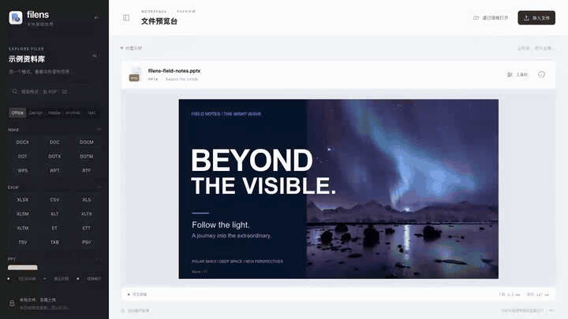

<div align="center">
  
  <h1>filens</h1>
  <p><strong>Files shine bright. Dreams take flight.</strong></p>
  <p>A pure frontend file viewer for Office, iWork, CAD, panoramas, and more. Local files stay on your device.</p>
  <p>English · <a href="README.zh-CN.md">简体中文</a></p>
  <p>
    <a href="#demo">Watch the demo</a> ·
    <a href="#quick-start">Try it locally</a> ·
    <a href="docs/support-matrix.md">Supported formats</a>
  </p>
</div>

[](apps/demo/public/home/filens-demo.mp4)

<p align="center"><strong>Pure frontend · WASM conversion, flexible deployment · Fast and tiny</strong></p>

## A closer look at your files

- **Pure frontend preview.** Parse and render files in the browser. Local previews require neither uploads nor a conversion server.
- **WASM conversion, flexible deployment.** Run the conversion module directly in the browser or use it independently through [CLI / HTTP tools](examples/go-wazero-converter). WASM handles file parsing and conversion; the server manages requests and files.
- **Load by format, spend less time waiting.** Format-based bundles, lazy loading, worker parsing, and page virtualization reduce download and rendering work. The document conversion WASM is **<!-- bundle-size:converter-core -->318.0<!-- /bundle-size --> KiB Brotli**; UI, shared dependencies, and other modules are measured separately in the [bundle report](docs/bundle-sizes.md).

Native PPTX and iWork previews sit alongside documents, spreadsheets, CAD, 3D, RAW, panoramas, archives, and ebooks. Coverage and fidelity vary by format. See the [support matrix](docs/support-matrix.md) for current capabilities and limitations.

## See more, right in your browser

**Open all three iWork formats, look around camera-original panoramas, and get a fast RAW preview.** From presentation slides to the data behind the lens, explore it all in one file workspace.

This comparison selects browser-local projects by specialty.

| Frontend project | Native PPTX preview | iWork | Panorama photos / video | Local RAW preview | CAD / 3D | Performance path and focus |
| --- | --- | --- | --- | --- | --- | --- |
| **filens** | **✅** | **✅ Keynote / Pages / Numbers** | **✅ Photos / video**<br><sub>◐ Insta360 / DJI distortion and calibration parsing, original-track sync and calibrated DNG stitching</sub> | **◐ Embedded JPEG / lightweight development** | **✅ DXF / STEP / 3D** | **Load by format; fast RAW path; panorama redraws on demand** |
| [vue-office](https://github.com/501351981/vue-office) | ✅ [PPTX core is not open source](https://github.com/501351981/pptx-preview#关于授权) | — | — | — | — | Office document previews |
| [PPTist](https://github.com/pipipi-pikachu/PPTist) | ✅ Import into presentation model | — | — | — | — | Presentation editing and playback |
| [SheetJS CE](https://docs.sheetjs.com/docs/miscellany/formats/) | — | ◐ Numbers table data extraction | — | — | — | Workbook parsing; application supplies the UI |
| [Photo Sphere Viewer](https://github.com/mistic100/Photo-Sphere-Viewer) | — | — | ✅ Photos / video<br><sub>◐ Pre-combined dual-fisheye sources</sub> | — | — | WebGL panoramas, tiles, hotspots, and tours |
| [LibRaw-Wasm](https://github.com/ybouane/LibRaw-Wasm) | — | — | — | ✅ WASM decoding and development | — | Full / half-size development; worker-based image processing API |
| [Online 3D Viewer](https://github.com/kovacsv/Online3DViewer) | — | — | — | — | ✅ STEP / IGES / IFC / 3D | Specialist model viewing, inspection, and export |

<sub>✅ Available path; ◐ partial or conditional support; — no built-in path found in the project's documentation. See the [support matrix](docs/support-matrix.md) for fidelity boundaries. Camera-original stitching is experimental.</sub>

- **iWork, with a view for each format.** Parse Keynote, Pages, and Numbers directly, presenting text, images, shapes, and tables on slide, page, and sheet canvases. [See an actual preview](apps/demo/public/home/iwork.webp).
- **Panoramas, from lens parameters to the view around you.** Parse supported originals' intrinsics, distortion, and extrinsics, then handle track synchronization, projection, exposure matching, and seams. Reuse static stitching results and adapt video seam-analysis frequency to its measured cost. [Implementation and camera validation](docs/panorama-rendering-implementation.md).
- **RAW, with a faster path to a preview.** Load the image WASM on demand, extract an embedded JPEG first, and use lightweight sensor development when no preview is available. [RAW coverage](docs/support-matrix.md#camera-raw-conversion).

## What you can open today

| Files | What you can do | Current limits |
| --- | --- | --- |
| PPTX, Keynote / Pages / Numbers | Browse slides, pages, and worksheets directly. | Native parsing; layout and object fidelity vary by file. |
| DOCX, XLSX / CSV, PDF | Read documents, switch worksheets, and browse PDF pages. | Read-only previews; fonts and advanced styles may differ. |
| DOC / XLS / PPT, WPS / ET / DPS | Normalize legacy documents locally for preview. | Preview-focused conversion strips macros and does not promise full reconstruction. |
| DXF, STEP / STP, 3D models | Explore drawings, orbit solids, and zoom into meshes. | STEP loads separately on demand; geometry and instance placement are retained, while source colors, names, and the assembly tree are omitted. |
| RAW, PPM, images, and icons | View camera originals and P3 / P6, 8 / 16-bit PPM files. | RAW uses embedded JPEGs or lightweight sensor development; camera support varies. |
| 360° photos and video | Look around; stitch supported Insta360 / DJI videos in real time and calibrated DNG photos at load. | Camera stitching is experimental and depends on calibration metadata, companion files, and browser codecs. |
| Archives, ebooks, code, mind maps, and diagrams | Browse folders and chapters, read source, and explore node relationships. | See the support matrix for each format's supported subset. |

The homepage has eight actual preview captures and directly accessible STEP, RAW, PPM, and legacy Office samples. See the [panorama package](packages/panorama/README.md) for RAW and panorama integration.

## Small pieces, shared capabilities

<!-- bundle-sizes:en:start -->
| Module / core | Raw | gzip | Brotli |
| --- | ---: | ---: | ---: |
| Conversion core WASM | 871.2 KiB | 395.2 KiB | **318.0 KiB** |
| Image / RAW core WASM | 1072.2 KiB | 293.0 KiB | **210.7 KiB** |
| Media / panorama preview | 210.4 KiB | 62.2 KiB | **53.1 KiB** |
| Optional STEP WASM | 2625.8 KiB | 1020.2 KiB | **797.0 KiB** |

Document, image / RAW, and STEP WASM modules load independently on demand. Media preview and image conversion are measured separately. JS rows include their CSS; shared dependencies and workers are listed separately.

<details>
<summary>All modules and initial loading cost</summary>

| Module / core | Raw | gzip | Brotli |
| --- | ---: | ---: | ---: |
| Demo entry | 173.1 KiB | 48.9 KiB | **40.9 KiB** |
| Shared vendor dependencies | 1776.4 KiB | 504.2 KiB | **414.7 KiB** |
| PPTX / core runtime | 284.1 KiB | 75.1 KiB | **64.3 KiB** |
| Vue preview host | 68.7 KiB | 15.9 KiB | **14.0 KiB** |
| DOCX / XLSX / PDF | 22.9 KiB | 7.3 KiB | **6.5 KiB** |
| iWork preview | 24.4 KiB | 8.1 KiB | **7.1 KiB** |
| CAD / mind maps / diagrams | 83.5 KiB | 23.7 KiB | **20.2 KiB** |
| 3D preview | 105.7 KiB | 28.2 KiB | **24.5 KiB** |
| Archive preview | 20.1 KiB | 6.4 KiB | **5.7 KiB** |
| Text / ebooks | 18.0 KiB | 6.2 KiB | **5.4 KiB** |
| iWork worker | 899.0 KiB | 188.2 KiB | **157.4 KiB** |
| PDF worker | 1053.3 KiB | 291.1 KiB | **233.1 KiB** |
| STEP loader | 23.0 KiB | 9.5 KiB | **8.7 KiB** |

Entry, preloaded JS, and CSS total **597.4 KiB Brotli** (2549.6 KiB raw / 718.6 KiB gzip), plus images, video, and samples. Modules share dependencies; these rows are not standalone per-format download totals.

</details>

Measured from the demo build. Compression columns describe artifacts; actual transfer depends on hosting. [Full report and reproduction](docs/bundle-sizes.md).
<!-- bundle-sizes:en:end -->

## Demo

**[▶ Watch the 30-second walkthrough](apps/demo/public/home/filens-demo.mp4)** — presentations, documents, spreadsheets, Keynote, CAD, and a 360° view, in one workspace.

<details>
<summary>Show an animated preview</summary>



The full recording is linked above. [Chinese captions](apps/demo/public/home/demo-zh.vtt) · [English captions](apps/demo/public/home/demo-en.vtt)

</details>

## Measured performance

**Stable leads against specialized frontend libraries.** Seven runs per configuration; sensor development and preview drawing on five RAW inputs without embedded JPEGs are **1.11–2.14×** faster than the measured LibRaw paths.

| Measured task | filens | Current peer | Peer time / filens | Result |
| --- | ---: | --- | ---: | --- |
| 11.1 MB, 13-slide PPTX parse | **34.3 ms** | pptx-preview 1.0.7: 57.7 ms | **1.68×** | **SOTA\*** |
| 11.1 MB, 13-slide PPTX first preview | **53.6 ms** | pptx-preview 1.0.7: 75.4 ms | **1.41×** | **SOTA\*** |
| 3840×1920 panorama JPEG preview | **154.9 ms** | Photo Sphere Viewer 5.15.1: 205.2 ms | **1.32×** | **SOTA\*** |
| NEF without embedded JPEG → preview canvas | **152.7 ms** | LibRaw-Wasm 1.6.0 half-size: 326.7 ms | **2.14×** | **SOTA\*** |
| DNG without embedded JPEG → preview canvas | **167.7 ms** | LibRaw-Wasm 1.6.0 fast half-size: 314.4 ms | **1.87×** | **SOTA\*** |
| STEP geometry import: cube | **46.5 ms** | occt-import-js 0.0.23: 67.6 ms | 1.45× | **SOTA\*** |
| XLSX data read (80,000 cells) | **42.3 ms** | SheetJS CE 0.20.3: 109.6 ms | 2.59× | **SOTA\*** |
| XLS → XLSX preview conversion (6 sheets) | **12.3 ms** | x2t WASM v9.3.2+3: 49.1 ms | 4.00× | **SOTA\*** |
| 20,000×8 numeric CSV → XLSX | **137.6 ms** | x2t WASM v9.3.2+3: 198.8 ms | 1.44× | **SOTA\*** |

<sub>\* Limited to this machine, measured inputs and listed peers, supported by paired bootstrap 95% intervals; downloads and library cold loading excluded. Apple M4 Pro / Chromium 147; **panoramas use SwiftShader software rendering**. RAW measures development and drawing to a common canvas with different intermediate sizes; STEP targets geometry previews; XLSX compares data reading; XLS compares the main displayed content in the same viewer. [Full results, scope and reproduction](docs/performance-comparison.md).</sub>

<details>
<summary>Selection and measurement scope</summary>

<sub>Entries follow public documentation and browser-local processing paths. SheetJS and LibRaw-Wasm expose APIs that need an application UI. Panorama viewing and vendor-original stitching have different requirements; see the [support matrix](docs/support-matrix.md) and [Photo Sphere Viewer dual-fisheye guide](https://photo-sphere-viewer.js.org/guide/adapters/dual-fisheye.html).</sub>

<sub>RAW inputs have embedded JPEGs removed and unchanged sensor data. Both LibRaw half-size configurations draw to the same 1280×800 canvas; intermediate resolution, tone and crop differ slightly. Timing includes development, output decode/transfer and drawing. The full Numbers model and several small PPTX first previews still have room to improve; see the [full results and preview comparisons](docs/performance-comparison.md).</sub>

</details>

## Quick start

Requires Node.js 20+ and [Rust via rustup](https://rustup.rs/). The repository pins the Rust compiler and WASI target.

```sh
npm ci
npm run build:wasm
npm run dev --workspace @filens/demo
```

Open [the local demo](http://localhost:5173/modules/filens/?lang=en), then choose a sample or drop in your own file. The website has Chinese and English homepages.

To publish the demo, [import the repository into Vercel](docs/deploy-vercel.md). Git integration deploys pushes automatically; an optional manual GitHub Actions workflow is also included.

## Build with filens

| Looking for… | Start here |
| --- | --- |
| Vue preview components | [Vue integration](packages/vue/README.md) |
| Format coverage and limits | [Support matrix](docs/support-matrix.md) |
| Architecture, comparisons, and performance notes | [Project overview](docs/project-overview.md) |
| Frontend timings, scoped leads, and raw data | [Frontend performance comparison](docs/performance-comparison.md) |
| CLI / backend integration | [Go + wazero example](examples/go-wazero-converter/README.md) |
| Deployment | [Vercel guide](docs/deploy-vercel.md) |

Try your everyday files and [report a reproducible issue](https://github.com/IceWhaleTech/filens/issues/new/choose). Upcoming work is tracked in the [roadmap](docs/roadmap.md).

<sub>Preview images come from filens itself. Photos: Carsten / CC BY 2.0 (cropped and pale-blue graded) and Greg Zaal / Poly Haven / CC0. The overview, walkthrough, and animated preview are CC BY-SA 4.0. <a href="docs/assets/readme/SOURCES.md">Visual sources and credits</a>. iWork research: <a href="https://github.com/dunhamsteve/iwork">dunhamsteve/iwork</a>; CAD lineage: <a href="https://github.com/orcastor/cad2x-converter">orcastor/cad2x-converter</a>.</sub>
