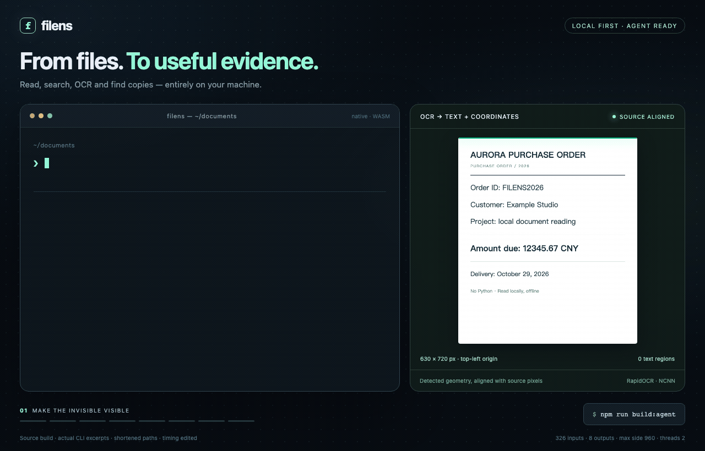
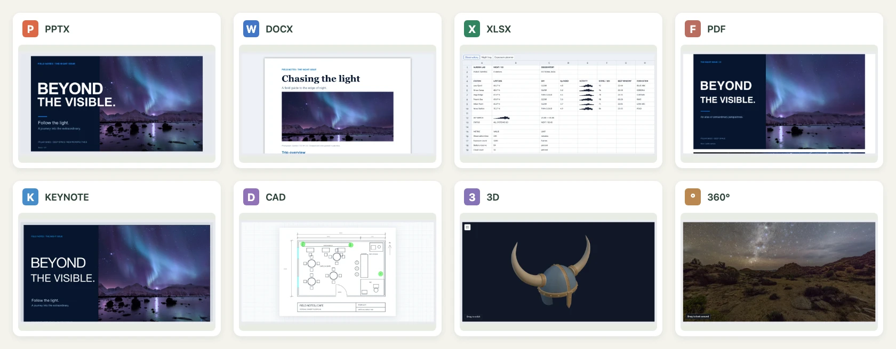
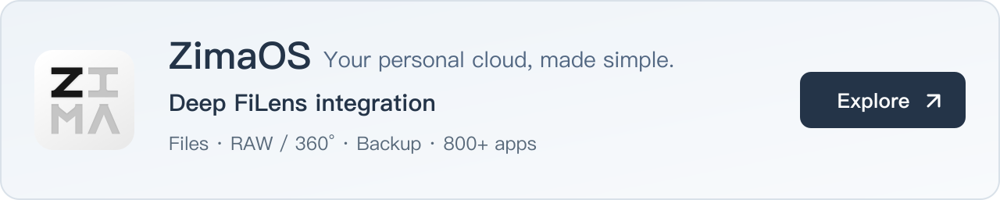

<div align="center">
  
  <h1>filens</h1>
  <p><strong>An Agent CLI. A pure frontend viewer for complex file formats.</strong></p>
  <p>Read, search, OCR, convert and preview local files. Files stay on your device.</p>
  <p>English · <a href="README.zh-CN.md">简体中文</a> · <a href="LICENSE">MIT</a></p>
</div>



[](apps/demo/public/home/filens-demo.mp4)

[▶ Watch the 30-second walkthrough](apps/demo/public/home/filens-demo.mp4) · [Animated preview](docs/assets/readme/demo.gif) · [Format coverage and limits](docs/support-matrix.md)

| | Agent CLI | Pure frontend previews |
| --- | --- | --- |
| Use it for | Give Agents source text, search results, OCR and cited evidence; open a browser preview. | Preview Office, iWork, PDF, CAD / 3D, RAW, panoramas, archives and more in your app. |
| Approximate size | **2 MB executable → 8 MB Lite → 30+ MB Full**, including OCR models. | **A few KB to hundreds of KB per compressed chunk**; shared dependencies, workers and WASM add to the total. An **all-in-one JS file** is also available. |
| Start here | [Install and use the CLI](#agent-cli) | [Preview and integrate](#pure-frontend-previews) |

Sizes describe different things: CLI figures are installed v0.4.0 packages (platform-dependent, excluding Node.js and optional preview assets). Frontend chunk figures describe compressed build artifacts. The full standalone runtime is about **2.7 MB Brotli** across split files, or **3.2 MB Brotli / 4.3 MB gzip / 14 MB raw** as one JS file, including Vue, styles, workers and WASM. [CLI measurements](docs/agent-cli-npm-release.json) · [Standalone measurements](docs/preview-build-sizes.json).

## Agent CLI

Read PDFs, Office documents, spreadsheets, scans and images locally. Search directories and nested archives; extract key original passages; find duplicate files and similar images. Outputs include text, JSON, Markdown, HTML, YAML, XML, CSV and TSV, with available page coordinates and document structure. Paraphrasing, translation and question answering belong to the calling Agent.

```sh
# Full: native RapidOCR and Chinese/English models; no Python
npm install -g filens-cli
filens 'read "report.pdf" as json'
filens 'search "./documents" for "budget risk" as json'
filens summarize report.pdf --query 'budget risk' --json
filens convert report.doc report.docx

# Lite: add OCR later with filens setup-ocr
npx --yes filens-cli-lite capacity --json
```

**Browser preview from the CLI:** `filens preview report.pdf` opens the shared frontend viewer. The first use installs the separate `filens-preview` package; `filens setup-preview` prepares it in advance. `--no-open --json` prints a local URL and keeps the server running until stopped. The optional frontend package includes both builds (about **26 MB installed**), measured separately from CLI sizes. [Preview setup and limits](packages/preview/README.md#cli-preview).

<details>
<summary>CLI sizes, capabilities and further examples</summary>

<!-- agent-cli-size:en:start -->
  <p><strong>CLI 2.15 MiB · Lite 8.04 MiB · Full 31.24 MiB · <a href="LICENSE">MIT</a></strong><br /><sub>v0.4.0 · macOS arm64 · installed packages, Full includes OCR models; <a href="docs/agent-cli-npm-release.json">all platform sizes</a></sub></p>
<!-- agent-cli-size:en:end -->

- [Installation, protocol and packaging](docs/agent-cli.md) · [Agent skill](skills/filens/SKILL.md)
- [Output formats and layouts](docs/agent-cli-formats-and-layout.zh-CN.md) · [68 observed examples and limits](docs/agent-cli-examples.zh-CN.md)
- [Search](docs/agent-cli-search.zh-CN.md), [nested archives](docs/agent-cli-search-archives.zh-CN.md) and [model-free key excerpts](docs/agent-cli-pruning.zh-CN.md)
- [Duplicates and similar images](docs/agent-cli-similarity.md) · [Windows setup and validation status](docs/agent-cli-windows.zh-CN.md)
- [Search coverage](docs/agent-cli-search-formats.zh-CN.md), [retrieval benchmarks](docs/agent-cli-search-benchmark.zh-CN.md) and [startup costs](docs/agent-cli-search-native.zh-CN.md)

The CLI uses Rust and the same frontend conversion core. Full bundles RapidOCR NCNN (max side 960, two OpenMP threads); Lite adds it with `filens setup-ocr`. Inspect `capacity` for the installed build's operations and conversion pairs. Natural-language requests recognize a bounded set of intents; page selection and field-specific questions are not implemented. Windows/Linux native execution remains pending validation.

**macOS OCR comparison:** Apple Vision is faster on the tested warm image calls, but loses tiny text and can be less accurate on blurred input; fresh-process latency is also higher. It cannot yet replace RapidOCR across this project's requirements. [Measurements, capability gaps and reproduction](docs/macos-ocr-benchmark.zh-CN.md).

</details>

## Pure frontend previews

**Complex formats, processed in the browser with no upload or conversion server.** Browse Keynote slides, Pages pages and Numbers sheets; read Office and PDF documents; inspect CAD and 3D models; view RAW photos and 360° photos or video.

### Single file or split modules

```sh
npm install filens-preview
```

The same API is available in both builds. Vue, styles and the conversion engines are included; your app needs no Vue installation.

```html
<div id="preview" style="height: 80vh"></div>
<script type="module">
  // Split build: deploy the entire split/ directory; engines load as needed.
  import { createPreview } from 'filens-preview';
  // Single-file alternative: deploy all-in-one/filens.js (styles, WASM and workers included).
  // import { createPreview } from 'filens-preview/all-in-one';

  const viewer = createPreview('#preview', { src: './report.pdf', name: 'report.pdf' });
  // viewer.update({ src: anotherFile, name: anotherFile.name });
  // viewer.destroy();
</script>
```

Use a bundler for npm imports, or deploy the package runtime directory and import its `filens.js` over HTTP(S). For a Vue app, use the shared [`Preview` component](packages/vue/README.md); for direct JavaScript integration and CLI previews, see the [standalone guide](packages/preview/README.md). Single-file packaging trades a larger initial download for simpler deployment; it has the same format limits as the split build.

| Files | Preview | Main limits |
| --- | --- | --- |
| PPTX, Keynote / Pages / Numbers | Slide, page and worksheet canvases. | Fidelity varies by layout, fonts and objects. |
| DOCX, XLSX / CSV, PDF | Documents, sheets and paged PDFs. | Read-only; advanced styling may differ. |
| DOC / XLS / PPT, WPS / ET / DPS | Local WASM conversion for preview. | Preview-focused; macros are stripped. |
| DXF, STEP / STP, mesh models | Pan drawings and orbit 3D geometry. | STEP omits source colors, names and assembly trees. |
| RAW, common images and icons | Embedded JPEG first, lightweight RAW development as fallback. | Camera coverage and image quality vary. |
| 360° photos and video | Interactive viewing and supported camera-original stitching. | Stitching is experimental; metadata, sidecars and browser codecs matter. |
| Archives, ebooks, code, mind maps and diagrams | Browse entries, chapters, source and node relationships. | Each format supports a documented subset. |

<details>
<summary>Detailed bundle sizes and loading costs</summary>

<!-- bundle-sizes:en:start -->
| Module / core | Raw | gzip | Brotli |
| --- | ---: | ---: | ---: |
| Conversion core WASM | 872.1 KiB | 395.6 KiB | **318.3 KiB** |
| Image / RAW core WASM | 1072.2 KiB | 293.0 KiB | **210.7 KiB** |
| Media / panorama preview | 216.9 KiB | 64.1 KiB | **54.7 KiB** |
| Rust STEP WASM (default) | 925.0 KiB | 326.3 KiB | **254.5 KiB** |
| OCCT STEP WASM (explicit option) | 2625.8 KiB | 1020.2 KiB | **797.0 KiB** |

Document, image / RAW, and STEP WASM modules load independently on demand. Media preview and image conversion are measured separately. JS rows include their CSS; shared dependencies and workers are listed separately.

<details>
<summary>All modules and initial loading cost</summary>

| Module / core | Raw | gzip | Brotli |
| --- | ---: | ---: | ---: |
| Demo entry | 173.1 KiB | 48.9 KiB | **40.8 KiB** |
| Shared vendor dependencies | 1319.8 KiB | 369.6 KiB | **305.2 KiB** |
| PPTX / core runtime | 288.6 KiB | 76.1 KiB | **65.4 KiB** |
| Vue preview host | 69.9 KiB | 16.3 KiB | **14.4 KiB** |
| DOCX / XLSX / PDF | 32.5 KiB | 9.8 KiB | **8.8 KiB** |
| On-demand PDF engine | 435.2 KiB | 128.1 KiB | **106.9 KiB** |
| iWork preview | 26.8 KiB | 8.7 KiB | **7.7 KiB** |
| CAD / mind maps / diagrams | 90.2 KiB | 25.2 KiB | **21.6 KiB** |
| 3D preview | 133.4 KiB | 37.9 KiB | **32.9 KiB** |
| Archive preview | 24.7 KiB | 7.9 KiB | **7.0 KiB** |
| Text / ebooks | 22.9 KiB | 8.2 KiB | **7.3 KiB** |
| iWork worker | 894.1 KiB | 186.7 KiB | **156.2 KiB** |
| PDF worker | 1053.3 KiB | 291.1 KiB | **233.1 KiB** |
| OCCT STEP loader (explicit option) | 23.0 KiB | 9.5 KiB | **8.7 KiB** |

Entry, preloaded JS, and CSS total **499.0 KiB Brotli** (2131.8 KiB raw / 596.6 KiB gzip), plus images, video, and samples. Modules share dependencies; these rows are not standalone per-format download totals.

</details>

Measured from the demo build. Compression columns describe artifacts; actual transfer depends on hosting. [Full report and reproduction](docs/bundle-sizes.md).
<!-- bundle-sizes:en:end -->

The table above is the recorded demo-build snapshot. The new standalone builds have their own [complete measurements](docs/preview-build-sizes.json), including embedded dependencies. Individual chunks are not independent per-format download totals.

</details>

<details>
<summary>Frontend project comparisons</summary>

| Frontend project | iWork | 360° photos / video | RAW preview | Native PPTX | CAD / 3D |
| --- | --- | --- | --- | --- | --- |
| **filens** | **✅ All three** | **✅** | **◐** | **✅** | **✅** |
| [SheetJS CE](https://docs.sheetjs.com/docs/miscellany/formats/) | ◐ Numbers | — | — | — | — |
| [Photo Sphere Viewer](https://github.com/mistic100/Photo-Sphere-Viewer) | — | ✅ | — | — | — |
| [LibRaw-Wasm](https://github.com/ybouane/LibRaw-Wasm) | — | — | ✅ | — | — |
| [vue-office](https://github.com/501351981/vue-office) | — | — | — | ✅ | — |
| [PPTist](https://github.com/pipipi-pikachu/PPTist) | — | — | — | ✅ | — |
| [Online 3D Viewer](https://github.com/kovacsv/Online3DViewer) | — | — | — | — | ✅ |

<sub>✅ Available path · ◐ Partial or conditional support · — No built-in path documented. [Format coverage and limits](docs/support-matrix.md).</sub>

**iWork, panoramas, RAW, Office, and CAD / 3D in one browser-local workspace.** The projects above specialize in different areas; filens brings these previews together.

<details>
<summary>Comparison notes and support boundaries</summary>

- Entries follow public documentation and browser-local processing paths, rather than overall project rankings. Support and fidelity vary by file.
- **iWork / PPTX:** filens previews Keynote, Pages, and Numbers natively. SheetJS extracts Numbers table data and needs an application UI. PPTist imports PPTX into its presentation model; vue-office's [PPTX core is not open source](https://github.com/501351981/pptx-preview#关于授权).
- **Panoramas:** both filens and Photo Sphere Viewer display photos and video. filens also handles supported X5 INSP originals, Insta360 / DJI calibration and distortion, original-track synchronization, and calibrated DNG stitching. Camera-original stitching is experimental and depends on metadata, companion files, and browser codecs. PSV's [generic dual-fisheye adapter](https://photo-sphere-viewer.js.org/guide/adapters/dual-fisheye.html) does not parse X5 calibration.
- **RAW:** filens prioritizes embedded JPEGs, then lightweight sensor development. LibRaw-Wasm offers full / half-size decoding and development through an API that needs an application UI. These paths have different image-quality goals.
- **CAD / 3D:** filens covers DXF, STEP, and mesh previews. Online 3D Viewer specializes in model viewing, inspection, and export, including STEP / IGES / IFC. filens STEP previews retain geometry and instance placement, but omit source colors, names, and the assembly tree.

</details>

</details>

## Run the demo locally

Requires Node.js 20+ and [Rust via rustup](https://rustup.rs/). The repository pins the Rust compiler and WASI target.

```sh
npm ci
npm run build:wasm
npm run dev --workspace @filens/demo
```

Open [the local demo](http://localhost:5173/modules/filens/?lang=en), choose a sample or drop in a file. For hosting, see the [Vercel guide](docs/deploy-vercel.md).

## Install on ZimaOS

<p align="center"><a href="https://www.zimaspace.com/en/zimaos?utm_source=github&amp;utm_medium=referral&amp;utm_campaign=filens_zimaos&amp;utm_content=readme_banner_en"></a></p>

Install FiLens from the official Mod Store. In the ZimaOS terminal or over SSH, run:

```sh
sudo zpkg install filens
```

This installs the native CLI and shared WASM engines for Linux x64/arm64, with no Node.js dependency. Run `filens capacity --json`, then `filens read report.pdf --json`. OCR reuses Photos' installed NCNN v7 runtime and RapidOCR models. If they are absent or incompatible, `filens setup-ocr` installs a compatible private copy; document reading and conversion work without OCR.

If the module is not found, run `sudo zpkg update` to refresh the store index, then retry. See the [ZimaOS packaging guide](packaging/zimaos/README.md) for building, publishing and updating the package.

## Performance and documentation

<details>
<summary>Show SOTA benchmark results</summary>

| Measured task | filens | Current peer | Speedup\* |
| --- | ---: | --- | ---: |
| 11.1 MB, 13-slide PPTX parse | **28.5 ms** | pptx-preview 1.0.7: 56.6 ms | **1.99×** |
| 11.1 MB, 13-slide PPTX first preview | **48.8 ms** | pptx-preview 1.0.7: 71.8 ms | **1.47×** |
| 3840×1920 panorama JPEG preview | **154.9 ms** | Photo Sphere Viewer 5.15.1: 205.2 ms | **1.32×** |
| 11904×5952 original X5 INSP panorama preview | **369.4 ms** | Photo Sphere Viewer 5.15.1 dual fisheye: 414.5 ms | **1.12×** |
| NEF without embedded JPEG → preview canvas | **152.7 ms** | LibRaw-Wasm 1.6.0 half-size: 326.7 ms | **2.14×** |
| DNG without embedded JPEG → preview canvas | **167.7 ms** | LibRaw-Wasm 1.6.0 fast half-size: 314.4 ms | **1.87×** |
| STEP geometry import: cube (prior OCCT baseline) | **46.5 ms** | occt-import-js 0.0.23: 67.6 ms | 1.45× |
| XLSX data read (80,000 cells) | **42.3 ms** | SheetJS CE 0.20.3: 109.6 ms | 2.59× |
| XLS → XLSX preview conversion (6 sheets) | **12.3 ms** | x2t WASM v9.3.2+3: 49.1 ms | 4.00× |
| 20,000×8 numeric CSV → XLSX | **137.6 ms** | x2t WASM v9.3.2+3: 198.8 ms | 1.44× |

**Stable leads against specialized frontend libraries.** At least seven runs per configuration, with 21 for the X5 original; sensor development and preview drawing on five RAW inputs without embedded JPEGs are **1.11–2.14×** faster than the measured LibRaw paths.

<sub>\* Limited to this machine, measured inputs and listed peers, supported by paired bootstrap 95% intervals; downloads and library cold loading excluded. Apple M4 Pro / Chromium 147; **panoramas use SwiftShader software rendering**. On the X5 original, PSV's generic dual-fisheye projection visibly repeats scene content across hard seams; filens has lighter, localized ghosting. The speed label covers readable previews of this original. RAW measures development and drawing to a common canvas with different intermediate sizes; STEP targets geometry previews; XLSX compares data reading; XLS compares the main displayed content in the same viewer. [Full results, scope and reproduction](docs/performance-comparison.md).</sub>

</details>

<details>
<summary>Measurement scope</summary>

<sub>RAW inputs have embedded JPEGs removed and unchanged sensor data. Both LibRaw half-size configurations draw to the same 1280×800 canvas; intermediate resolution, tone and crop differ slightly. Timing includes development, output decode/transfer and drawing. The full Numbers model and several small PPTX first previews still have room to improve; see the [full results and preview comparisons](docs/performance-comparison.md).</sub>

</details>

| Looking for… | Start here |
| --- | --- |
| Standalone single-file / split builds and CLI preview | [Preview guide](packages/preview/README.md) |
| Vue integration | [Vue components](packages/vue/README.md) |
| Supported formats | [Support matrix](docs/support-matrix.md) |
| Architecture and WASM boundaries | [Project overview](docs/project-overview.md) |
| Frontend benchmarks and raw data | [Performance comparison](docs/performance-comparison.md) |
| macOS native OCR vs RapidOCR | [Measured comparison](docs/macos-ocr-benchmark.zh-CN.md) |
| CLI and backend integration | [Agent CLI](docs/agent-cli.md) · [Go + wazero host](examples/go-wazero-converter/README.md) |

Try your files and [report a reproducible issue](https://github.com/IceWhaleTech/filens/issues/new/choose). [Roadmap](docs/roadmap.md) · [MIT license](LICENSE) · [Third-party notices](packaging/agent-third-party.md).

<sub>Preview captures come from filens. Photos and demo recordings retain their original licenses; see <a href="docs/assets/readme/SOURCES.md">visual sources and credits</a>. iWork research: <a href="https://github.com/dunhamsteve/iwork">dunhamsteve/iwork</a>; CAD lineage: <a href="https://github.com/orcastor/cad2x-converter">orcastor/cad2x-converter</a>.</sub>

## Star History

[](https://star-history.com/#IceWhaleTech/filens&Date)
