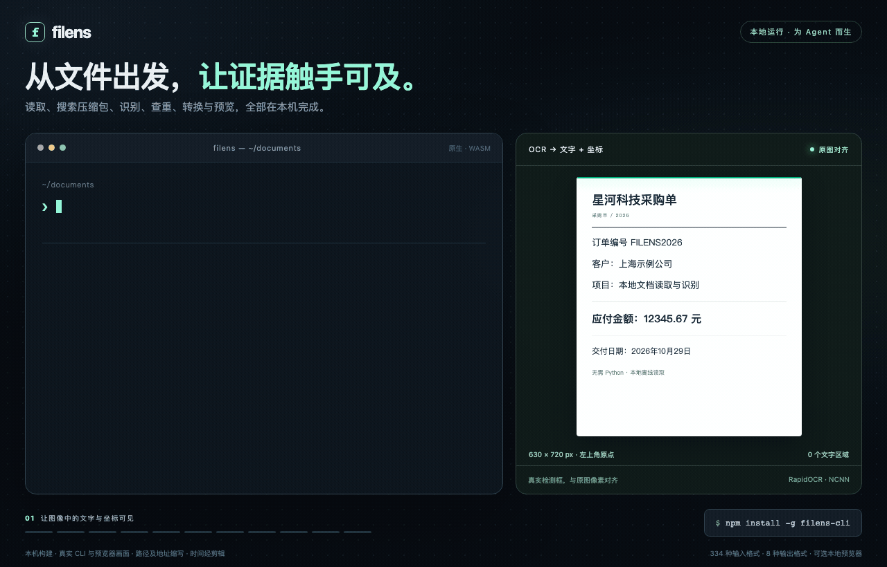

<div align="center">
  
  <h1>探微 · filens</h1>
  <p><strong>给 Agent 的 CLI，也是一套纯前端复杂格式预览工具。</strong></p>
  <p>本地读取、搜索、OCR、转换与预览，文件无需上传。</p>
  <p><a href="README.md">English</a> · 简体中文 · <a href="LICENSE">MIT</a></p>
</div>



[](apps/demo/public/home/filens-demo.mp4)

[▶ 观看 30 秒演示](apps/demo/public/home/filens-demo.mp4) · [预览动图](docs/assets/readme/demo.gif) · [完整格式与限制](docs/support-matrix.zh-CN.md)

| | Agent CLI | 纯前端预览 |
| --- | --- | --- |
| 用来做什么 | 向 Agent 提供文档原文、搜索结果、OCR 与可定位证据，也可打开浏览器预览。 | 在应用中预览 Office、iWork、PDF、CAD / 3D、RAW、全景、压缩包等大量复杂格式。 |
| 大概多大 | **可执行文件约 2 MB → Lite 约 8 MB → Full 约 30 多 MB**，完整版含 OCR 模型。 | **压缩后单个分包几 KB 到几百 KB**，共享依赖、Worker、WASM 另计；也提供 **all-in-one 单 JS 文件**。 |
| 从这里开始 | [安装与使用 CLI](#agent-cli) | [预览与接入](#纯前端预览) |

两边体积分别计量：CLI 是 v0.4.1 的安装体积，随平台变化，不含 Node.js 和可选预览资源；前端分包说的是压缩产物。完整独立预览运行时按分包合计约 **10.9 MB Brotli**，单文件版约 **14.2 MB Brotli / 19.6 MB gzip / 60 MB 原始体积**，已包含 Vue、样式、Worker 与 WASM。0.1.1 新增 HEIC/HEIF 解码和视频引擎，分包版按需加载视频引擎。[CLI 各平台实测](docs/agent-cli-npm-release.json) · [独立预览构建实测](docs/preview-build-sizes.json)。

## Agent CLI

本地读取 PDF、Office、表格、扫描件和图片；搜索目录与嵌套压缩包、提取关键原文、查找重复文件与相似图片。输出 text、JSON、Markdown、HTML、YAML、XML、CSV 或 TSV，保留可用的页码坐标与文档结构。改写总结、翻译和问答由调用它的 Agent 完成。

```sh
# 完整版：自带原生 RapidOCR 与中英文模型，无需 Python
npm install -g filens-cli
filens '读取 "report.pdf"，以 JSON 输出'
filens '在 "./documents" 中搜索 "预算 风险"，以 JSON 输出'
filens summarize report.pdf --query '预算 风险' --json
filens convert report.doc report.docx

# 轻量版：需要 OCR 时再运行 filens setup-ocr
npx --yes filens-cli-lite capacity --json
```

**用 CLI 打开预览：**`filens preview report.pdf` 打开共享前端预览器；首次运行自动安装独立的 `filens-preview` 包，也可先运行 `filens setup-preview`。`--no-open --json` 返回本地地址，服务保持运行直到退出。可选前端包同时包含两种构建，完整安装约 **108 MB**，与 CLI 体积分开计量。[预览配置与限制](packages/preview/README.md#cli-preview)。

<details>
<summary>CLI 精确体积、能力与更多示例</summary>

<!-- agent-cli-size:zh:start -->
  <p><strong>CLI 2.15 MiB · Lite 8.04 MiB · Full 31.25 MiB · <a href="LICENSE">MIT</a></strong><br /><sub>v0.4.1 · macOS arm64 · 包安装体积，Full 含 OCR 模型；<a href="docs/agent-cli-npm-release.json">各平台完整数据</a></sub></p>
<!-- agent-cli-size:zh:end -->

- [安装、协议与打包](docs/agent-cli.md) · [Agent skill](skills/filens/SKILL.md)
- [输出格式与布局信息](docs/agent-cli-formats-and-layout.zh-CN.md) · [68 条实测案例与自然语言边界](docs/agent-cli-examples.zh-CN.md)
- [跨格式搜索](docs/agent-cli-search.zh-CN.md)、[嵌套压缩包](docs/agent-cli-search-archives.zh-CN.md)与[无模型关键原文摘录](docs/agent-cli-pruning.zh-CN.md)
- [重复文件与相似图片](docs/agent-cli-similarity.md) · [Windows 安装与验证状态](docs/agent-cli-windows.zh-CN.md)
- [搜索覆盖](docs/agent-cli-search-formats.zh-CN.md)、[检索基准](docs/agent-cli-search-benchmark.zh-CN.md)与[启动成本](docs/agent-cli-search-native.zh-CN.md)

CLI 使用 Rust，转换复用前端核心。Full 内置 RapidOCR NCNN（最大边长 960、OpenMP 线程 2），Lite 可用 `filens setup-ocr` 补齐。用 `capacity` 查看当前安装版本的操作与转换组合。自然语言只识别有限意图，尚不支持选择页码、按问题筛选字段。Windows / Linux 原生执行仍待实机验证。

**macOS OCR 对比：**本机图片实测中，Apple Vision 热调用更快，但漏掉极小字，模糊输入也不总是更准；首次启动反而更慢。目前不能全面替代 RapidOCR。[实测、能力差异与复现](docs/macos-ocr-benchmark.zh-CN.md)。

</details>

## 纯前端预览

**大量复杂格式，在浏览器本地解析和渲染，无需上传或转换服务器。** 直接浏览 Keynote 幻灯片、Pages 页面、Numbers 表格，读取 Office 与 PDF，检查 CAD / 3D 模型，查看 RAW 和 360° 照片、视频。

### 单文件与按需分包，两种选择

```sh
npm install filens-preview
```

两种构建使用同一 API，均包含 Vue、样式和转换引擎，宿主应用不需要安装 Vue。

```html
<div id="preview" style="height: 80vh"></div>
<script type="module">
  // 分包版：部署整个 split/ 目录，引擎按需加载。
  import { createPreview } from 'filens-preview';
  // 单文件版：只部署 all-in-one/filens.js，已内嵌样式、WASM 与 Worker。
  // import { createPreview } from 'filens-preview/all-in-one';

  const viewer = createPreview('#preview', { src: './report.pdf', name: 'report.pdf' });
  // viewer.update({ src: anotherFile, name: anotherFile.name });
  // viewer.destroy();
</script>
```

npm 导入需配合打包器；也可直接部署包内运行时目录，通过 HTTP(S) 导入 `filens.js`。Vue 应用也可直接使用统一的 [`Preview` 组件](packages/vue/README.md)；独立 JS 接入与 CLI 预览见[接入指南](packages/preview/README.md)。单文件版部署简单、首次下载更大，格式能力与分包版一致。

| 文件 | 可以怎样预览 | 主要限制 |
| --- | --- | --- |
| PPTX、Keynote / Pages / Numbers | 幻灯片、页面和工作表画布。 | 布局、字体和对象保真度随文件变化。 |
| DOCX、XLSX / CSV、PDF | 文档、工作表与分页 PDF。 | 只读，复杂样式可能不同。 |
| DOC / XLS / PPT、WPS / ET / DPS | 本地 WASM 转换后预览。 | 面向预览，移除宏。 |
| DXF、STEP / STP、网格模型 | 平移图纸、旋转与缩放三维几何。 | STEP 不保留源颜色、名称和装配树。 |
| RAW、常见图片和图标 | 优先读取内嵌 JPEG，否则轻量显影。 | 相机覆盖和成像质量有差异。 |
| 360° 照片与视频 | 交互查看及部分相机原片拼接。 | 原片拼接为实验性，依赖标定、伴随文件与浏览器编解码器。 |
| 压缩包、电子书、代码、思维导图和流程图 | 浏览条目、章节、源码与节点关系。 | 各格式支持范围见格式矩阵。 |

<details>
<summary>展开查看分包精确体积与加载成本</summary>

<!-- bundle-sizes:zh:start -->
| 分包 / 核心 | 原始 | gzip | Brotli |
| --- | ---: | ---: | ---: |
| 转换核心 WASM | 872.1 KiB | 395.6 KiB | **318.3 KiB** |
| 图像 / RAW 核心 WASM | 1072.2 KiB | 293.0 KiB | **210.7 KiB** |
| 媒体 / 全景预览 | 216.9 KiB | 64.1 KiB | **54.7 KiB** |
| STEP Rust WASM（默认） | 925.0 KiB | 326.3 KiB | **254.5 KiB** |
| STEP OCCT WASM（显式可选） | 2625.8 KiB | 1020.2 KiB | **797.0 KiB** |

文档、图像 / RAW 与 STEP 的 WASM 模块独立按需加载；媒体预览模块与图像转换核心分别计量。JS 分包已包含对应 CSS，共享依赖和 Worker 单列。

<details>
<summary>展开查看全部分包及首屏成本</summary>

| 分包 / 核心 | 原始 | gzip | Brotli |
| --- | ---: | ---: | ---: |
| 演示站入口 | 173.1 KiB | 48.9 KiB | **40.8 KiB** |
| 共享第三方依赖 | 1319.8 KiB | 369.6 KiB | **305.2 KiB** |
| PPTX / 核心运行时 | 288.6 KiB | 76.1 KiB | **65.4 KiB** |
| Vue 预览容器 | 69.9 KiB | 16.3 KiB | **14.4 KiB** |
| DOCX / XLSX / PDF | 32.5 KiB | 9.8 KiB | **8.8 KiB** |
| PDF 按需引擎 | 435.2 KiB | 128.1 KiB | **106.9 KiB** |
| iWork 预览 | 26.8 KiB | 8.7 KiB | **7.7 KiB** |
| CAD / 思维导图 / 流程图 | 90.2 KiB | 25.2 KiB | **21.6 KiB** |
| 3D 预览 | 133.4 KiB | 37.9 KiB | **32.9 KiB** |
| 压缩包预览 | 24.7 KiB | 7.9 KiB | **7.0 KiB** |
| 文本 / 电子书 | 22.9 KiB | 8.2 KiB | **7.3 KiB** |
| iWork Worker | 894.1 KiB | 186.7 KiB | **156.2 KiB** |
| PDF Worker | 1053.3 KiB | 291.1 KiB | **233.1 KiB** |
| STEP OCCT 加载器（显式可选） | 23.0 KiB | 9.5 KiB | **8.7 KiB** |

本次构建的入口、预加载 JS 与 CSS 合计 **499.0 KiB Brotli**（原始 2131.8 KiB / gzip 596.6 KiB），另计图片、视频和示例文件。模块会共享依赖；上述体积不代表每种格式的独立总下载量。

</details>

数据来自实际演示站构建。压缩列是产物体积，实际传输取决于托管配置。[完整报告与复现方式](docs/bundle-sizes.md)。
<!-- bundle-sizes:zh:end -->

上表为已记录的演示站构建快照；新增独立构建的[完整实测](docs/preview-build-sizes.json)另外计量，已包含内嵌依赖。单个分包不代表该格式全部下载成本。

</details>

<details>
<summary>与其他前端项目的能力对比</summary>

| 前端项目 | iWork | 全景照片 / 视频 | RAW 预览 | 原生 PPTX | CAD / 3D |
| --- | --- | --- | --- | --- | --- |
| **filens** | **✅ 三件套** | **✅** | **◐** | **✅** | **✅** |
| [SheetJS CE](https://docs.sheetjs.com/docs/miscellany/formats/) | ◐ Numbers | — | — | — | — |
| [Photo Sphere Viewer](https://github.com/mistic100/Photo-Sphere-Viewer) | — | ✅ | — | — | — |
| [LibRaw-Wasm](https://github.com/ybouane/LibRaw-Wasm) | — | — | ✅ | — | — |
| [vue-office](https://github.com/501351981/vue-office) | — | — | — | ✅ | — |
| [PPTist](https://github.com/pipipi-pikachu/PPTist) | — | — | — | ✅ | — |
| [Online 3D Viewer](https://github.com/kovacsv/Online3DViewer) | — | — | — | — | ✅ |

<sub>✅ 已提供该路径 · ◐ 部分或有条件支持 · — 未见文档记载内置路径。[格式覆盖与边界](docs/support-matrix.zh-CN.md)。</sub>

**iWork、全景、RAW、Office 与 CAD / 3D，在同一个浏览器本地工作台打开。** 上述项目各有所长，filens 将这些预览能力放在一起。

<details>
<summary>对比注记与支持边界</summary>

- 依据各项目公开文档，比较浏览器本地处理路径，不作项目综合排名。具体支持范围与保真程度因文件而异。
- **iWork / PPTX：** filens 原生预览 Keynote、Pages 和 Numbers。SheetJS 提取 Numbers 表格数据，需应用接入界面。PPTist 将 PPTX 导入为演示模型；vue-office 的 [PPTX 核心未开源](https://github.com/501351981/pptx-preview#关于授权)。
- **全景：** filens 与 Photo Sphere Viewer 均可显示照片和视频。filens 还处理受支持的 X5 INSP 原片、Insta360 / DJI 标定与畸变、原片多轨同步及标定 DNG 拼接。相机原片拼接为实验性能力，依赖元数据、配套文件和浏览器编解码器。PSV 的[通用双鱼眼适配器](https://photo-sphere-viewer.js.org/guide/adapters/dual-fisheye.html)不解析 X5 标定。
- **RAW：** filens 优先提取内嵌 JPEG，再走轻量传感器显影；LibRaw-Wasm 通过 API 提供全尺寸 / 半尺寸解码与显影，需应用接入界面。两者的画质目标不同。
- **CAD / 3D：** filens 提供 DXF、STEP 与网格预览。Online 3D Viewer 专注模型浏览、检查与导出，包括 STEP / IGES / IFC。filens 的 STEP 预览保留几何与实例位置，不输出原始颜色、名称和装配树。

</details>

</details>

## 本地运行演示站

需要 Node.js 20+ 与 [Rust / rustup](https://rustup.rs/)，仓库固定 Rust 编译器和 WASI target。

```sh
npm ci
npm run build:wasm
npm run dev --workspace @filens/demo
```

打开[本地演示站](http://localhost:5173/modules/filens/?lang=zh)，选择样例或拖入文件。部署见 [Vercel 指南](docs/deploy-vercel.md)。

## 在 ZimaOS 上安装

<p align="center"><a href="https://www.zimaspace.com/zh/zimaos?utm_source=github&amp;utm_medium=referral&amp;utm_campaign=filens_zimaos&amp;utm_content=readme_banner_zh"></a></p>

从官方 Mod Store 安装 FiLens，在 ZimaOS 终端或通过 SSH 执行：

```sh
sudo zpkg install filens
```

安装包包含 Linux x64 / arm64 原生 CLI 和共享 WASM 引擎，无需 Node.js。安装后运行 `filens capacity --json` 检查能力，再用 `filens read report.pdf --json` 读取文件。OCR 自动复用 Photos 已安装的 NCNN v7 运行库与 RapidOCR 模型；缺少组件或版本不兼容时，运行 `filens setup-ocr` 安装 FiLens 私有的兼容组件，不改动 Photos。文档读取和转换也可在没有 OCR 时使用。

如果提示找不到模块，先执行 `sudo zpkg update` 刷新商店索引，再重试安装。构建、发布及更新方法见 [ZimaOS 打包说明](packaging/zimaos/README.md)。

## 性能与文档

<details>
<summary>展开查看 SOTA 实测对比</summary>

| 实测任务 | filens | 当前对照 | 加速比\* |
| --- | ---: | --- | ---: |
| 11.1 MB、13 页 PPTX 解析 | **28.5 ms** | pptx-preview 1.0.7：56.6 ms | **1.99×** |
| 11.1 MB、13 页 PPTX 首屏 | **48.8 ms** | pptx-preview 1.0.7：71.8 ms | **1.47×** |
| 3840×1920 全景 JPEG 首屏 | **154.9 ms** | Photo Sphere Viewer 5.15.1：205.2 ms | **1.32×** |
| 11904×5952 X5 INSP 原片全景首屏 | **369.4 ms** | Photo Sphere Viewer 5.15.1 双鱼眼：414.5 ms | **1.12×** |
| 无内嵌 JPEG 的 NEF → 预览画布 | **152.7 ms** | LibRaw-Wasm 1.6.0 半尺寸：326.7 ms | **2.14×** |
| 无内嵌 JPEG 的 DNG → 预览画布 | **167.7 ms** | LibRaw-Wasm 1.6.0 快速半尺寸：314.4 ms | **1.87×** |
| STEP 几何导入：cube（旧 OCCT 基线） | **46.5 ms** | occt-import-js 0.0.23: 67.6 ms | 1.45× |
| XLSX 数据读取（80,000 单元格） | **42.3 ms** | SheetJS CE 0.20.3: 109.6 ms | 2.59× |
| XLS → XLSX 预览转换（6 工作表） | **12.3 ms** | x2t WASM v9.3.2+3: 49.1 ms | 4.00× |
| 20,000×8 数值 CSV → XLSX | **137.6 ms** | x2t WASM v9.3.2+3: 198.8 ms | 1.44× |

**与专业前端方案同场实测，多条路径稳定领先。** 每组重复至少 7 次；X5 原片重复 21 次。无内嵌 JPEG 的 5 份 RAW 样例，显影并绘制预览比所测 LibRaw 方案快 **1.11–2.14×**。

<sub>\* 仅指本机、已测样例及表列对手，配对 bootstrap 95% 区间支持的领先；不含下载和库冷加载。Apple M4 Pro / Chromium 147；**全景使用 SwiftShader 软件渲染**。X5 原片中，PSV 通用双鱼眼投影有明显画面重复与硬接缝，filens 的局部重影更轻；速度标注限于这份原片的可读预览。RAW 比较统一画布上的显影与绘制，中间输出尺寸不同；STEP 面向几何预览；XLSX 仅比较数据读取；XLS 以相同预览器中的主要显示内容为准。[完整结果、边界与复现](docs/performance-comparison.zh-CN.md)。</sub>

</details>

<details>
<summary>实测口径</summary>

<sub>RAW 使用移除内嵌 JPEG、传感器数据未变的输入；对比 LibRaw 两种半尺寸配置，统一绘制到 1280×800 画布。中间输出分辨率、色调和裁切略有不同；计时包含显影、输出解码 / 传输与绘制。Numbers 完整模型和部分小 PPTX 首屏仍有优化空间，详见[完整实测与画面对照](docs/performance-comparison.zh-CN.md)。</sub>

</details>

| 想了解什么 | 从这里开始 |
| --- | --- |
| 独立单文件 / 分包构建、CLI 预览 | [预览接入指南](packages/preview/README.md) |
| Vue 接入 | [Vue 组件](packages/vue/README.md) |
| 格式支持范围 | [格式矩阵](docs/support-matrix.zh-CN.md) |
| 架构与 WASM 边界 | [项目概览](docs/project-overview.zh-CN.md) |
| 前端基准与原始数据 | [性能对比](docs/performance-comparison.zh-CN.md) |
| macOS 原生 OCR 与 RapidOCR | [实测对比](docs/macos-ocr-benchmark.zh-CN.md) |
| CLI 与后端接入 | [Agent CLI](docs/agent-cli.md) · [Go + wazero 薄壳](examples/go-wazero-converter/README.md) |

欢迎用日常文件测试并[提交可复现问题](https://github.com/IceWhaleTech/filens/issues/new/choose)。[路线图](docs/roadmap.md) · [MIT 许可](LICENSE) · [第三方声明](packaging/agent-third-party.md)。

<sub>预览截图来自 filens。照片与演示录像保留原许可，见<a href="docs/assets/readme/SOURCES.md">视觉来源与署名</a>。iWork 研究参考 <a href="https://github.com/dunhamsteve/iwork">dunhamsteve/iwork</a>；CAD 参考 <a href="https://github.com/orcastor/cad2x-converter">orcastor/cad2x-converter</a>。</sub>

## Star 历史

[](https://star-history.com/#IceWhaleTech/filens&Date)
