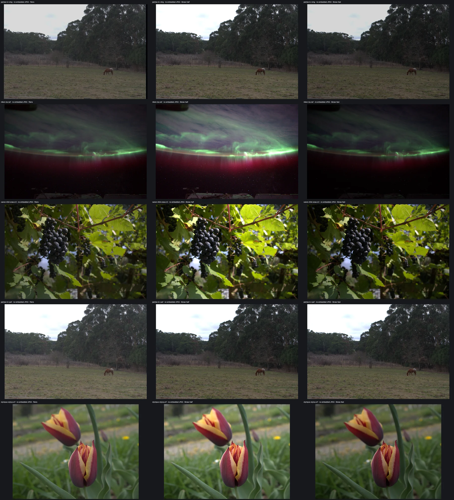
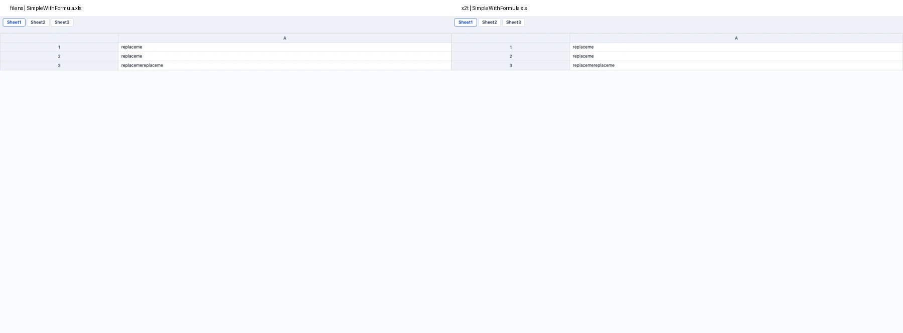
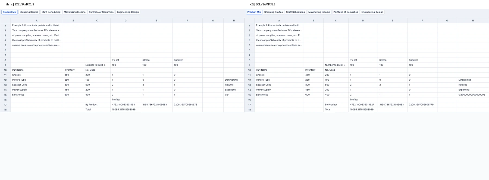

# 浏览器前端性能对比

2026-10-23 / 24 · Apple M4 Pro · Chromium 147 · **2,324 次比较测量，每项 7 次；其中 filens 945 / 945 次成功。** 另保留 28 次裁剪 CR3 夹具的诊断记录。

PPTX、全景、无内嵌 JPEG 的 RAW、STEP、XLSX 和文档预览转换均有稳定领先项。对比表忽略 10 ms 以内的任务。以用户实际阅读预览为目标；不要求转换结果保留相同的可编辑内部结构。

| 实测任务 | filens | 对照 | 对手 / filens（95% 区间） | 判定 |
| --- | --- | --- | --- | --- |
| 11.1 MB / 13 页 PPTX 解析 | **28.5 ms** | pptx-preview 1.0.7: 56.6 ms | 1.99× (1.94–2.12) | **SOTA\*** |
| 11.1 MB / 13 页 PPTX 首屏 | **48.8 ms** | pptx-preview 1.0.7: 71.8 ms | 1.47× (1.41–1.51) | **SOTA\*** |
| 3840×1920 全景 JPEG 首屏 | **154.9 ms** | Photo Sphere Viewer 5.15.1: 205.2 ms | 1.32× (1.29–1.37) | **SOTA\*** |
| 无内嵌 JPEG 的 NEF → 预览画布 | **152.7 ms** | LibRaw 半尺寸：326.7 ms | 2.14× (2.10–2.17) | **SOTA\*** |
| 无内嵌 JPEG 的 DNG → 预览画布 | **167.7 ms** | LibRaw 快速半尺寸：314.4 ms | 1.87× (1.78–1.91) | **SOTA\*** |
| STEP 几何导入：cube | **46.5 ms** | occt-import-js: 67.6 ms | 1.45× (1.43–1.63) | **SOTA\*** |
| XLSX 数据读取（80,000 单元格） | **42.3 ms** | sheetjs: 109.6 ms | 2.59× (2.38–2.71) | **SOTA\*** |
| XLS → XLSX 预览转换（6 工作表） | **12.3 ms** | x2t: 49.1 ms | 4.00× (3.91–4.13) | **SOTA\*** |
| 20,000×8 数值 CSV → XLSX | **137.6 ms** | x2t: 198.8 ms | 1.44× (1.41–1.46) | **SOTA\*** |

\* SOTA 仅指本机、所测样例、表列对手及对应任务的稳定领先：配对 bootstrap 95% 区间下界大于 1。XLSX 数据读取不代表完整样式解析；XLS 转换按相同预览器中的显示结果比较。**全景使用 SwiftShader 软件渲染。** 不含下载与库冷加载；完整数据保留落后项和失败项。

## RAW：没有内嵌 JPEG，也能快速看到原片

移除相机样例的内嵌 JPEG 后，从传感器数据生成预览。五份完整样例均稳定领先 [LibRaw-Wasm 1.6.0](https://github.com/ybouane/LibRaw-Wasm) 的两种半尺寸配置，速度为较快对手的 **1.11–2.14×**。

| 输入 | filens（ms） | LibRaw 半尺寸（ms） | LibRaw 快速半尺寸（ms） | 较快对手 / filens（95% 区间） | 判定 |
| --- | ---: | ---: | ---: | --- | --- |
| Pentax K-r DNG | **167.7** | 320.6 | 314.4 | **1.87×** (1.78–1.91) | **SOTA\*** |
| Nikon D3S NEF | **152.7** | 326.7 | 328.2 | **2.14×** (2.10–2.17) | **SOTA\*** |
| Canon 40D sRAW CR2 | **132.0** | 148.1 | 146.6 | **1.11×** (1.06–1.15) | **SOTA\*** |
| Pentax K-r PEF | **187.6** | 289.2 | 288.6 | **1.54×** (1.52–1.58) | **SOTA\*** |
| Olympus Stylus ORF | **352.3** | 408.1 | 409.9 | **1.16×** (1.14–1.27) | **SOTA\*** |

计时到预览画布绘制完成，包含传感器解码、色彩处理、filens 的 JPEG 编解码或 LibRaw 的 RGB 传输，以及统一 1280×800 画布的缩放绘制。双方中间输出分辨率、裁切与色调不同；这是可读预览任务的比较。LibRaw 两组均用相机白平衡和半尺寸，快速组另关闭自动增亮、请求固定 sRGB 曲线并应用 DNG 曝光元数据。输入与库初始化在计时前完成，每组 7 次；全部 105 次有效运行成功，预览像素在重复运行间稳定。

颜色参照 Photos 的处理约定：相机白平衡、正确的相机到 sRGB 矩阵、高光裁剪、固定 sRGB 曲线和有符号 DNG BaselineExposure；无效标定明确报错。灰阶 / 曝光测试验证 18% 灰约为 118，−1 / +1 EV 约为 85 / 162。预览保留色调差异，不宣称还原相机图片风格。

画面对照、输出尺寸与显示等待

每行依次为 filens、LibRaw 半尺寸、LibRaw 快速半尺寸；五行对应上表。相同场景与方向可读，高光天空不再偏紫。移除的仅是标准 8 位显示 JPEG，保留高位深传感器压缩；解包后的传感器数据哈希一致，Canon sRAW 则核对完整处理 RGB。

| 输入 | filens 中间尺寸 | LibRaw 半尺寸 / 快速组中间尺寸 | filens 加显示等待（ms） | LibRaw 半尺寸 / 快速组加显示等待（ms） |
| --- | --- | --- | ---: | --- |
| DNG | 1451×956 | 2154×1434 | 188.4 | 342.6 / 336.9 |
| NEF | 1419×944 | 2142×1422 | 173.1 | 346.0 / 345.7 |
| CR2 | 1944×1296 | 1944×1296 | 156.0 | 153.9 / 152.6 |
| PEF | 1436×956 | 2154×1434 | 206.4 | 309.6 / 307.3 |
| ORF | 1993×1496 | 1992×1496 | 380.6 | 426.0 / 428.4 |

显示等待另加两个动画帧，不作为上表显影 / 绘制的排名指标；CR2 在这项中没有领先。filens 普通预览上限仍为 2048 像素。样例 canon-r6.cr3 来自 Exiv2 的 Canon-R6-pruned.CR3 元数据夹具：移除 JPEG 后不含可用的完整场景，filens 与 LibRaw 半尺寸无图，LibRaw 完整解包输出黑图。因此其 28 次诊断保留但排除传感器排名，不据此判断完整 CR3 原片的支持情况。

## 文档预览转换：对比 ONLYOFFICE x2t WASM

对照 [x2t v9.3.2+3](https://github.com/cryptpad/onlyoffice-x2t-wasm/releases/tag/v9.3.2+3)。两边转换结果均交给同一套 filens 预览器；基础 XLS 的全部工作表显示单元格一致，较复杂 XLS 的主体预览接近；公式的存储方式不影响这项预览判定。

| 输入 | filens 转换（ms） | x2t 转换（ms） | x2t 初始化 + 转换（ms） | 预览结果 |
| --- | ---: | ---: | ---: | --- |
| legacy-project-workflow.doc | 23.6 | 43.2 | 74.1 | 正文可读，分页和间距有差异 |
| hyperlink.doc | 11.2 | 22.1 | 50.8 | 超链接文字完整显示 |
| table-merges.doc | 11.6 | 23.1 | 54.2 | 表格文字方向有差异 |
| Simple.xls | 10.2 | 27.7 | 58.7 | 预览单元格一致 · **SOTA\*** |
| SimpleWithFormula.xls | 10.3 | 29.8 | 59.4 | 预览单元格一致 · **SOTA\*** |
| SOLVSAMP.XLS | 12.3 | 49.1 | 80.6 | 主体预览接近，小数位与空白网格有细微差异 · **SOTA\*** |
| legacy-sample-show.ppt | 10.2 | 46.5 | 77.0 | 文字与布局有差异 |
| rich-text.rtf | 11.0 | 24.6 | 54.7 | 表格与分页有差异 |
| sample.odt | 10.5 | — | — | x2t 输出空 ZIP，校验失败 |
| convert-numeric.csv | 137.6 | 198.8 | 227.1 | 160,000 单元格完整且一致 · **SOTA\*** |
| convert-numeric-8000.csv | 64.8 | 96.6 | 128.2 | 64,000 单元格完整且一致 · **SOTA\*** |
| generated-notes.txt | 15.6 | 24.0 | 52.9 | 全文一致，默认字体与页宽不同 |

转换时间包含输入写入和输出读取。WASM 已编译，x2t 初始化单列；filens 的 WASI 实例创建已计入转换。未额外安装字体。DOC / PPT / RTF 保留实测速度，画面有明显差异的样例不标 SOTA；不因可编辑公式或段落结构不同而直接排除。XLS 预览允许末尾小数位和空白网格差异；签名按 12 位有效数字比较显示数值，同时校验全部非空单元格地址与文字。

| 文档转换 WASM | filens | x2t |
| --- | ---: | ---: |
| 原始字节 | **892,101** | 38,768,424 |
| Brotli 11 | **325,537** | 7,124,169 |

仅比较 WASM，按相同压缩参数重算；JS 适配层、预览器、字体与其他模块另计。filens 的转换核心 Brotli 体积约为 x2t 的 **1/21.9**，能力范围见[支持矩阵](support-matrix.zh-CN.md)。20,000 行 CSV 已完整转换；超出 1,000,000 个单元格或每行 16,384 列时明确报错，不再静默截断。ODT 是最小测试夹具，其失败不代表 x2t 的通用 ODT 支持情况。

查看实际预览对照

左 filens，右 x2t；两边使用相同预览器、1280×900、DPR 1。文字、布尔值和 DOC 域结果均通过实际预览检查。以下展示基础公式 XLS 与较复杂 XLS 的首个工作表，全部工作表的检查记录见原始证据。

## STEP：更小的几何预览核心

与 Online 3D Viewer 使用的 [occt-import-js 0.0.23](https://github.com/kovacsv/occt-import-js) 对照，六份文件的几何导入均稳定领先。

| 文件 | 三角形 | filens（ms） | 上游（ms） | 上游 / filens |
| --- | ---: | ---: | ---: | ---: |
| cube.stp | 12 | 46.5 | 67.6 | 1.45× |
| rounded-cube.step | 84 | 52.2 | 79.2 | 1.52× |
| as1_pe_203.stp | 3,848 | 147.7 | 180.5 | 1.22× |
| as1-oc-214.stp | 5,040 | 266.7 | 289.5 | 1.09× |
| dm1-oc-214.stp | 1,904 | 171.9 | 196.8 | 1.15× |
| tailturbine.stp | 3,622 | 148.9 | 175.1 | 1.18× |

世界坐标三角形与法线签名一致；另外通过 55 份真实文件、165 次导入的数值回归。filens 面向几何预览，省去原始颜色、名称和装配树。WASM Brotli 从上游的 2,315,009 降到 **816,177 字节，减少 64.7%**；这不是完整 CAD 元数据导入的排名。

## 其他类别与落后项

| 任务 | filens（ms） | 更快的对照（ms） |
| --- | ---: | --- |
| DXF：20,000 条线 | 29.8 | dxf-parser: 19.5 |
| CSV：20,000×8 数值字段 | 11.7 | papaparse: 7.9 |
| ZIP：1,000 个小文件，解包全部 | 11.4 | fflate: 4.2 |

CSV 同时测 PapaParse 5.7.0 和 SheetJS CE 0.20.3；ZIP 同时测 fflate 0.8.2 和 zip.js 2.24.0，按更快的对手呈现。DXF 对照 dxf-parser 1.1.2。不能仅因胜过其中一个较慢实现就标 SOTA。PDF、DOCX 和多数 3D 加载器复用现有引擎，不额外宣称独立算法领先。

XLSX：大工作簿

| 输入 | 非空单元格 | filens（ms） | SheetJS CE 0.20.3（ms） | 判定 |
| --- | ---: | ---: | ---: | --- |
| generated-80000-cells.xlsx | 80,000 | 42.3 | 109.6 | **SOTA\*** |

对齐工作表、单元格地址、缓存值及公式字段；未评分样式、图表和完整工作簿功能。小文件的毫秒级优势不外推到大工作簿。

PPTX：完整解析与首屏结果

| 文件 | MB | filens 解析 | PPTist 解析器 | pptx-preview 解析 | filens 首屏 | pptx-preview 单页 | vue-office 首屏 |
| --- | --- | --- | --- | --- | --- | --- | --- |
| vue-office-test.pptx | 11.12 | 28.5 | 70.3 | 56.6 | 48.8 | 71.8 | 108.8 |
| filens-field-notes.pptx | 0.66 | 11.5 | 23.5 | 失败 | 45.1 | 失败 | 失败 |
| rich-pptx-shapes.pptx | 0.13 | 10.9 | 23.2 | 12.7 | 48.7 | 42.3 | 50.8 |
| rich-pptx-pictures.pptx | 0.09 | — | 11.1 | — | 27.5 | 30.9 | 39.4 |
| sample-deck.pptx | 0.07 | 10.4 | 失败 | 失败 | 37.3 | 失败 | 失败 |
| poi-SampleShow.pptx | 0.04 | — | 14.1 | 13.4 | 28.7 | 18.2 | 19.7 |
| poi-pie-chart.pptx | 0.06 | — | 11.8 | 13.4 | 25.4 | 40.5 | 40.1 |
| poi-2411-Performance_Up.pptx | 0.65 | 24.5 | 失败 | 33.6 | 61.5 | 52.2 | 97.0 |

单位 ms，10 ms 以内的解析值省略。filens 只挂载可见页面，低缩放时仍完整挂载全部可见页；pptx-preview 为单页，vue-office 为默认整份 DOM。小文件尚未全面领先，小图片首屏的独立复测优势不稳定，不标 SOTA；pie-chart 两个对照均未显示饼图，Performance_Up 对照首屏显示不同页；这些速度仅供参考。失败不计为 0。vue-office 的 [PPTX 核心未开源](https://github.com/501351981/pptx-preview#关于授权)。

iWork、全景与优化前后

| 输入 | 任务 | filens（ms） | 对照（ms） |
| --- | --- | --- | --- |
| a.numbers | 原生画布首屏 | 83.7 | — |
| a.numbers | 完整模型 / 数据提取 | 35.4 | SheetJS CE 0.20.3: 26.0 |
| a.pages | 原生画布首屏 | 66.3 | — |
| filens-weekend.key | 原生画布首屏 | 61.3 | — |
| insta360-oners-tallinn.jpg | 全景 JPEG 首屏 | 273.2 | Photo Sphere Viewer: 363.3 |
| osmo-360-leipzig.jpg | 全景 JPEG 首屏 | 154.9 | Photo Sphere Viewer: 205.2 |

Numbers 的 filens 模型含 6 张工作表、14 个表格及画布、样式；SheetJS 提取为 14 个工作簿条目，数据提取仍更快。已修复行分块顺序和稀疏尾列漏读；全部 5,772 个非空单元格地址及字符串值与 SheetJS 一致，数字按原文档格式显示。Pages / Keynote 尚无纳入实测的同等原生画布对照。厂商畸变 / 标定解析、多轨原片同步与拼接没有同等前端实测对手，普通全景 JPEG 的速度不用于推断拼接排名。

| 任务 | 优化前（ms） | 优化后（ms） | 前 / 后 |
| --- | --- | --- | --- |
| 11.1 MB PPTX 解析 | 45.3 | 28.5 | 1.59× |
| 11.1 MB PPTX 首屏 | 69.3 | 48.8 | 1.42× |
| Numbers 完整模型 | 125.5 | 35.4 | 3.54× |
| Numbers 原生首屏 | 187.3 | 83.7 | 2.24× |
| SampleShow PPTX 首屏 | 30.7 | 28.7 | 1.07× |
| shapes PPTX 首屏 | 62.5 | 48.7 | 1.28× |
| sample-deck PPTX 首屏 | 52.0 | 37.3 | 1.40× |
| 6528×3264 全景首屏 | 568.4 | 273.2 | 2.08× |
| 3840×1920 全景首屏 | 276.1 | 154.9 | 1.78× |
| DXF：20,000 条线解析 | 39.2 | 29.8 | 1.32× |
| XLSX：80,000 单元格读取 | 145.6 | 42.3 | 3.44× |
| ZIP：1,000 个小文件解压 | 54.8 | 11.4 | 4.82× |
| CSV：20,000×8 数据读取 | 18.2 | 11.7 | 1.56× |

历史基线未完全隔离机器负载，前后倍数只作工程参考。两秒静止窗口中，filens 与 Photo Sphere Viewer 都是 0 次 GL 绘制；filens 优化前约 99–101 次。优化覆盖 PPTX 解包 / XML / 滚动、iWork 查找缓存、全景按需绘制与 RAW 快速预览 / 显影；格式处理继续集中于前端 TS / WASM。

## 数据与复现

[首次 525 次实测摘要](../benchmarks/frontend/2026-10-23/summary.json) · [原始记录](../benchmarks/frontend/2026-10-23/final.json.gz) · [新增 497 次实测摘要](../benchmarks/frontend/2026-10-23/other-formats-optimized-summary.json) · [原始记录](../benchmarks/frontend/2026-10-23/other-formats-optimized.json.gz) · [预览检查](../benchmarks/frontend/2026-10-23/preview-review-optimized.json) · [依赖锁与复现](../benchmarks/frontend/README.md)。

无内嵌 JPEG 的 RAW：[105 次有效比较与 28 次诊断摘要](../benchmarks/frontend/2026-10-24/raw-sensor-summary.json) · [完整原始记录](../benchmarks/frontend/2026-10-24/raw-sensor.json.gz) · [绑定数据哈希的画面检查](../benchmarks/frontend/2026-10-24/raw-sensor-review.json)。

此前 371 次复测：[PPTX 首屏](../benchmarks/frontend/2026-10-24/pptx-preview-optimized-summary.json) · [PPTX 解析](../benchmarks/frontend/2026-10-24/pptx-model-optimized-summary.json) · [Numbers](../benchmarks/frontend/2026-10-24/numbers-optimized-summary.json) · [iWork 首屏](../benchmarks/frontend/2026-10-24/iwork-preview-optimized-summary.json) · [内容与交互校验](../benchmarks/frontend/2026-10-24/frontend-optimized-review.json)。

追加 35 次 iWork 复测：[Numbers 完整模型](../benchmarks/frontend/2026-10-24/numbers-refined-summary.json) · [iWork 首屏](../benchmarks/frontend/2026-10-24/iwork-preview-refined-summary.json) · [完整模型、画面与切表校验](../benchmarks/frontend/2026-10-24/iwork-refined-review.json)。完整 Numbers 样式模型及三种 iWork 首屏像素与前版一致；Pages 本次耗时略高，未计作优化收益。

追加 392 次复测：[PPTX 解析](../benchmarks/frontend/2026-10-24/pptx-model-fastxml-summary.json) · [PPTX 首屏](../benchmarks/frontend/2026-10-24/pptx-preview-fastxml-summary.json) · [Numbers](../benchmarks/frontend/2026-10-24/numbers-buffered-summary.json) · [iWork 首屏](../benchmarks/frontend/2026-10-24/iwork-preview-buffered-summary.json) · [独立复测与完整内容检查](../benchmarks/frontend/2026-10-24/frontend-fastxml-review.json)。

8 份 PPTX 完整模型、Numbers 全部单元格及 11 张首屏画面与前版一致。另做 28 次新旧实现同场工程复测：Numbers 完整模型耗时降低约 5%，原生首屏没有稳定收益；本次 iWork 首屏耗时较前组更高，保留实测值。

追加 35 次 iWork 复测：[Numbers 完整模型](../benchmarks/frontend/2026-10-24/numbers-indexed-summary.json) · [iWork 首屏](../benchmarks/frontend/2026-10-24/iwork-preview-indexed-summary.json) · [完整内容与同场对照](../benchmarks/frontend/2026-10-24/iwork-indexed-review.json)。

六份 iWork 完整归档与模型、三张首屏画面均与前版一致。另做 56 次新旧实现同场测量：Numbers 完整模型耗时降低约 14%，原生首屏收益尚不稳定；不新增 SOTA 标注。

追加 21 次原生首屏复测：[iWork 首屏](../benchmarks/frontend/2026-10-24/iwork-preview-resize-summary.json) · [同场对照](../benchmarks/frontend/2026-10-24/iwork-preview-resize-ab-summary.json) · [画面、内容与窗口缩放检查](../benchmarks/frontend/2026-10-24/iwork-resize-review.json)。

42 次新旧实现同场测量中，Numbers 首屏耗时降低约 20%；Pages / Keynote 没有稳定收益。三张首屏画面、全部工作表和归档内容一致。窗口缩放保留已加载行与当前页；尚无同等原生前端对手，不新增 SOTA 标注。

追加 7 次 Numbers 首屏复测：[首屏结果](../benchmarks/frontend/2026-10-24/numbers-preview-visibility-summary.json) · [同场对照](../benchmarks/frontend/2026-10-24/numbers-preview-visibility-ab-summary.json) · [完整内容与逐表滚动检查](../benchmarks/frontend/2026-10-24/numbers-visibility-review.json)。

首屏中位数 83.7 ms；14 次新旧同场测量确认耗时降低约 12%，首屏像素一致，全部 14 个表格滚动可读。完整解析与 SOTA 判定不变。

追加 336 次 PPTX 复测：[完整解析](../benchmarks/frontend/2026-10-24/pptx-model-lazy-summary.json) · [首屏](../benchmarks/frontend/2026-10-24/pptx-preview-lazy-summary.json) · [同场对照与完整内容检查](../benchmarks/frontend/2026-10-24/pptx-lazy-review.json)。

11.1 MB PPTX 的完整解析和首屏同场耗时分别降低约 16% / 11%；8 份完整模型和首屏画面一致。小文件首屏收益不稳定，本轮较慢的结果和对照失败均保留。

Apple M4 Pro / 24 GiB / macOS arm64；Chromium 147.0.7727.15，1280×800、DPR 1，无 CPU 降速。每次用新 context，共享浏览器进程，轮换对手顺序；库、字节和 WASM 编译在计时前完成。首屏等待内容解码、字体和两个动画帧；全景双方均计入构造。95% 区间使用 10,000 次配对重采样、固定种子 12345。记录的主线程 JS 堆不含 WASM、Worker 和 GPU 内存。[优化前快照](../benchmarks/frontend/2026-10-23/baseline.json.gz) · [修正后的全景基线](../benchmarks/frontend/2026-10-23/panorama-baseline.json.gz)。
