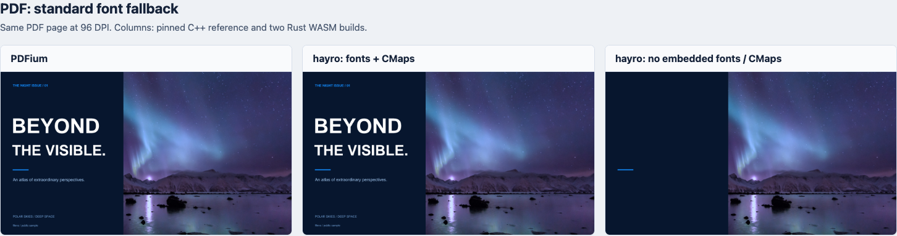
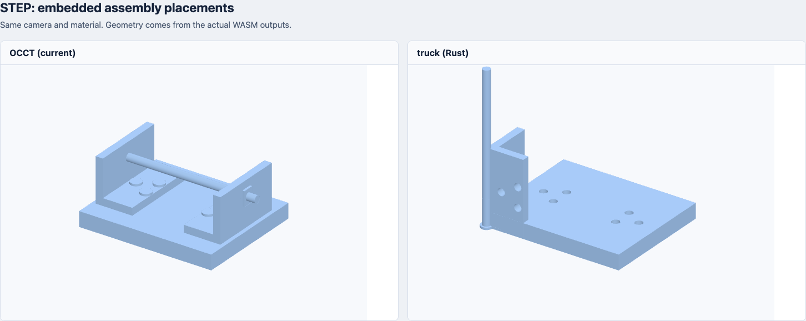
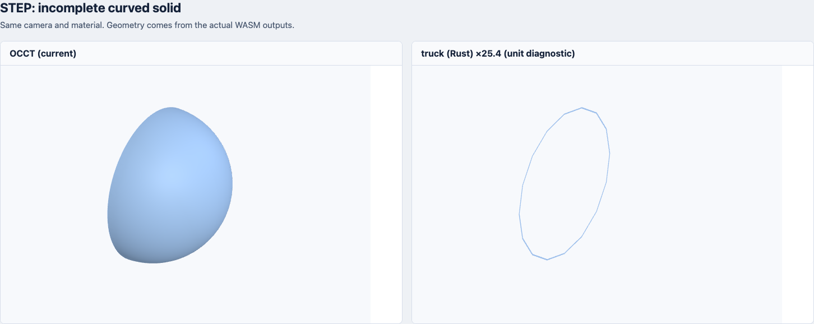

# Rust PDF / STEP 引擎实测

2026-10-29，Apple M4 Pro / macOS arm64 / Node v20.20.2。实际执行编译后的 WASM，未替换产品引擎。

后续排查：[STEP 不显示问题与修复复测](step-display-diagnosis.zh-CN.md)。本页保留修复前的原始结果。

**PDF：带标准字体/CMap 的 hayro 压缩体积只减少约 14%，原始体积反而增加；去掉这些资源会导致实际文档缺字。STEP：truck 压缩体积减少约 70%，但当前实验适配器尚不能保留整个现有语料的几何、单位与装配行为。**

## 体积

所有条目重新使用 gzip level 9 / Brotli quality 11 压缩，单位 KiB（1024 字节）。

| 引擎 | 原始 WASM | gzip | Brotli |
| --- | ---: | ---: | ---: |
| PDFium，现有 | 3899.5 | 1947.8 | 1555.7 |
| hayro，内嵌标准字体与 CMap | 4076.5 | 1689.0 | 1334.9 |
| hayro，不内嵌标准字体与 CMap | 3817.3 | 1461.0 | 1121.2 |
| OCCT，现有 | 2625.8 | 1020.2 | 797.0 |
| truck，实验适配器 | 879.8 | 305.5 | 238.4 |

- hayro 带资源版：gzip 减少 **13.3%**，Brotli 减少 **14.2%**；原始体积增加 **4.5%**。
- hayro 不内嵌资源版：Brotli 减少 **27.9%**，但标准字体依赖的文字会消失。外置后重新加载字体/CMap，也必须计入总下载量。
- truck：Brotli 减少 **70.1%**。这是当前能力范围内的候选，尚不能作为等价替代的体积。

Rust 使用 1.93.0、wasm32-wasip1、opt-level=z、LTO、单 codegen unit、panic=abort、strip，再用 Binaryen 131 的 -Oz 优化。候选体积含小型 WASI/JSON/文件适配层；PDFium/OCCT 是项目现有发布 WASM。JS 加载器、WASI 宿主与浏览器 PDF.js 未计入这张引擎表。两个 C++ 引擎已经优化过，未重新编译。

## PDF 效果

固定 hayro 0.8.0；PDFium 使用项目固定的 go-pdfium v1.17.3 WASM，SHA-256 随原始结果记录。

6 份公开/仓库 PDF 中选取 **12 页**，覆盖演示文件、扫描页、中文异常 CMap、88 页 Python 文档首中末页、18 页 Type3 文档首中末页。另验证 1 份密码文件在未提供密码时被三个引擎拒绝。

带资源版和不内嵌资源版均成功返回 12 页图像，尺寸与参考一致。但“返回图像成功”不代表内容完整：不内嵌资源版在演示首页中输出 **0 字符**，图像也没有标题、正文和页脚；带资源版保留了这些文字。



本次使用 hayro 的 GlyphRun / as_unicode 接口收集文字，仅移除空白后与原始 PDFium 输出比较：带资源版 **8/12** 一致，不内嵌资源版 **5/12** 一致。扫描页的空文字也包含在一致项内。没有实现段落阅读顺序、字体信息和文字矩形等完整宿主接口。

Type3 样例的文字可以渲染，但本次 hayro 字符抽取没有 Unicode 映射；项目现有流程也将这类文件转到 OCR，因此不能将字符串不同直接判为渲染失败。异常字体表格中，两个引擎的数字均存在问题，印章显示也有差异。这里比较的是**原始引擎**，没有运行项目的 ToUnicode 修复、OCR 和版面流程；PDFium 输出也不是这些损坏文件的正确答案。

| 页面 | hayro 带资源版像素 MAE | 带资源版文字 | 不内嵌资源版文字 |
| --- | ---: | --- | --- |
| demo-cover | 0.24% | 一致 | 有差异 |
| demo-page2 | 0.43% | 一致 | 有差异 |
| demo-page3 | 0.14% | 一致 | 有差异 |
| scan | 0.03% | 一致 | 一致 |
| unicode-radicals | 0.69% | 一致 | 一致 |
| unicode-missing-font | 2.12% | 有差异 | 有差异 |
| python-first | 1.35% | 一致 | 一致 |
| python-middle | 0.74% | 一致 | 一致 |
| python-last | 0.14% | 一致 | 一致 |
| type3-first | 1.48% | 有差异 | 有差异 |
| type3-middle | 1.73% | 有差异 | 有差异 |
| type3-last | 0.28% | 有差异 | 有差异 |

MAE 是 RGB 绝对误差除以 255 后的平均值；抗锯齿和字体替代也会产生误差。大面积白底可能掩盖缺字，不能单靠这个数值判断效果。

更多图像：[异常字体/CMap 表格](assets/rust-engines/pdf-unicode.png)、[Type3 页面](assets/rust-engines/pdf-type3.png)。本轮不覆盖全部 PDF 图像编码、交互表单与注释行为，未完成 CLI 整条替换路径的验证。

## STEP 效果

使用 truck 提交 `78d699b0792b39e27c2bf073b682986701644e91` 的 STEP/装配/三角化 API，跟随其 step-to-mesh 示例。该提交与测试时 master `1ca3214e` 的几何源码相同，后续差异仅涉及依赖和 CI/日志；选择它以匹配已安装的 Rust 1.93。没有修改第三方算法。

适配器优先走装配 API；没有得到网格时，使用上游已发布示例中的直接 shell 导入路径，并在结果标记 `shellFallback`。单位转换和装配适配尚未补齐；下面的结果描述的是这个实验候选，不能解释为 truck 永远无法实现相关能力。

occt-import-js 0.0.23 的 **55 个 STEP 文件**中，现有 OCCT 有 **44 个**输出非空几何，另外 11 个在基线中也无可显示几何，单独列出。

| 44 个基线非空文件的结果 | 数量 |
| --- | ---: |
| truck 输出非空网格 | 37 |
| 通过当前几何筛查 | 19 |
| 输出了网格但未通过筛查 | 18 |
| 错误、trap 或 20 秒超时 | 7 |

发现的具体问题：

- 单位：英寸和米立方体分别需要乘 25.4、1000，才能匹配参考毫米坐标；另两份文件的边界差异也可由 25.4 倍解释。报告保留诊断，未修正候选输出或将其算作通过。
- 装配：毫米单位的 as1-tu-203.stp 中，参考的横杆在候选中竖起，部分零件没有处于参考位置。这一差异独立于英寸换算。
- 缺面：HEAD_FRONT.stp 的 5 个面中，有 4 个三角化结果缺失。对比图给候选额外乘 25.4，仅为排除单位差异、展示缺面。
- 稳定性：rounded-cube.step 在候选中超过 20 秒，记为超时；其他部分曲面文件返回错误或触发 WASM trap。





两端请求线性三角化容差 0.1；OCCT 的输出单位指定为毫米，truck 仍按源坐标使用该容差。这也是当前候选的单位适配缺口。不同内核不要求三角形数量相同。

筛查要求：无已知缺失三角化面；边界最大偏差小于参考对角线 1%；表面积相对误差小于 3%；有符号体积相对误差小于 5%；双向采样表面距离 P95 不超过 max(0.2 mm, 参考对角线的 0.1%)。每方向最多采样 1024 个三角形的顶点和重心，共 2048 点。筛查通过仍不等于逐面、逐法线或精确 CAD 等价。

<details><summary>55 文件逐项结果</summary>

| 文件 | OCCT 三角形 | truck 三角形 | 结果 |
| --- | ---: | ---: | --- |
| cax-if/as1-oc-214.stp | 5180 | 28716 | 筛查通过 |
| cax-if/as1-oc-214/as1-oc-214.stp | 5180 | 28716 | 筛查通过 |
| cax-if/as1-tu-203.stp | 4736 | 15280 | 几何 / 单位 / 装配差异 |
| cax-if/as1_pe_203.stp | 16512 | 992 | 几何 / 单位 / 装配差异 |
| cax-if/dm1-id-214.stp | 1612 | 586 | 几何 / 单位 / 装配差异 |
| cax-if/dm1-oc-214.stp | 1928 | 8988 | 筛查通过 |
| cax-if/dm1-pe-214.stp | 6208 | 952 | 几何 / 单位 / 装配差异 |
| cax-if/io1-cm-214.stp | 2536 | — | 错误 / trap |
| cax-if/io1-tu-203.stp | 1880 | 4912 | 筛查通过 |
| cax-if/s1-c5-214/FOOT.stp | 0 | 0 | 基线也无可显示几何 |
| cax-if/s1-c5-214/FOOT_BACK_000.stp | 1230 | — | 错误 / trap |
| cax-if/s1-c5-214/FOOT_FRONT_000.stp | 1230 | — | 错误 / trap |
| cax-if/s1-c5-214/HEAD.stp | 0 | 0 | 基线也无可显示几何 |
| cax-if/s1-c5-214/HEAD_BACK.stp | 8160 | — | 错误 / trap |
| cax-if/s1-c5-214/HEAD_FRONT.stp | 6340 | 32 | 几何 / 单位 / 装配差异 |
| cax-if/s1-c5-214/MAINBODY.stp | 0 | 0 | 基线也无可显示几何 |
| cax-if/s1-c5-214/MAINBODY_BACK.stp | 14944 | — | 错误 / trap |
| cax-if/s1-c5-214/MAINBODY_FRONT.stp | 13938 | — | 错误 / trap |
| cax-if/s1-c5-214/TAIL.stp | 0 | 0 | 基线也无可显示几何 |
| cax-if/s1-c5-214/TAIL_MIDDLE_PART.stp | 236 | 57 | 几何 / 单位 / 装配差异 |
| cax-if/s1-c5-214/TAIL_TURBINE.stp | 306 | 94 | 几何 / 单位 / 装配差异 |
| cax-if/s1-c5-214/s1-c5-214.stp | 0 | — | 基线也无可显示几何 |
| cax-if/s1-tu-203/footback.stp | 1872 | 3588 | 筛查通过 |
| cax-if/s1-tu-203/footfront.stp | 3184 | 3499 | 筛查通过 |
| cax-if/s1-tu-203/headback.stp | 12840 | 13500 | 筛查通过 |
| cax-if/s1-tu-203/headfront.stp | 11952 | 9427 | 筛查通过 |
| cax-if/s1-tu-203/mainbodyback.stp | 12724 | 22680 | 筛查通过 |
| cax-if/s1-tu-203/mainbodyfront.stp | 15022 | 22264 | 筛查通过 |
| cax-if/s1-tu-203/s1-tu-203.stp | 0 | 0 | 基线也无可显示几何 |
| cax-if/s1-tu-203/tailmiddlepart.stp | 236 | 352 | 筛查通过 |
| cax-if/s1-tu-203/tailturbine.stp | 4416 | 3592 | 筛查通过 |
| cax-if/s1_pe_214/foot_asm.stp | 0 | 0 | 基线也无可显示几何 |
| cax-if/s1_pe_214/foot_back_prt.stp | 1180 | 103 | 几何 / 单位 / 装配差异 |
| cax-if/s1_pe_214/foot_front_prt.stp | 1200 | 119 | 几何 / 单位 / 装配差异 |
| cax-if/s1_pe_214/head_asm.stp | 0 | 0 | 基线也无可显示几何 |
| cax-if/s1_pe_214/head_back_prt.stp | 6512 | 417 | 几何 / 单位 / 装配差异 |
| cax-if/s1_pe_214/head_front_prt.stp | 6324 | 365 | 几何 / 单位 / 装配差异 |
| cax-if/s1_pe_214/main_body_back_prt.stp | 13636 | 1436 | 几何 / 单位 / 装配差异 |
| cax-if/s1_pe_214/main_body_front_prt.stp | 14772 | 1716 | 几何 / 单位 / 装配差异 |
| cax-if/s1_pe_214/mainbody_asm.stp | 0 | 0 | 基线也无可显示几何 |
| cax-if/s1_pe_214/s1_pe_214.stp | 0 | 0 | 基线也无可显示几何 |
| cax-if/s1_pe_214/tail_asm.stp | 0 | 0 | 基线也无可显示几何 |
| cax-if/s1_pe_214/tail_middle_part_prt.stp | 404 | 132 | 几何 / 单位 / 装配差异 |
| cax-if/s1_pe_214/tail_turbine_prt.stp | 332 | 122 | 几何 / 单位 / 装配差异 |
| cax-if/sg1-c5-214.stp | 2040 | 696 | 筛查通过 |
| conical-surface/conical-surface.step | 416 | 50 | 几何 / 单位 / 装配差异 |
| cube-10x10mm/Cube 10x10.stp | 12 | 12 | 筛查通过 |
| cube-fcstd/cube.step | 12 | 12 | 筛查通过 |
| cube-fcstd/cube2.step | 12 | 12 | 筛查通过 |
| cube-fcstd/cube3.step | 12 | 12 | 筛查通过 |
| cube-units/cube-in.step | 12 | 12 | 几何 / 单位 / 装配差异 |
| cube-units/cube-m.step | 12 | 12 | 几何 / 单位 / 装配差异 |
| cube-units/cube-mm.step | 12 | 12 | 筛查通过 |
| rounded-cube/rounded-cube.step | 40 | — | 20 秒超时 |
| simple-basic-cube/cube.stp | 12 | 12 | 筛查通过 |

</details>

## 结论与复现

当前保留 PDFium 和已裁剪的 OCCT。hayro 有独立 Rust 实现的价值，但带资源后的体积收益有限，还需要完整文字/版面/OCR 接口验证。truck 有明显的体积潜力，需要先在 WASM 内完善单位、装配和曲面兼容，再用同一语料复测。

所有解析和转换均运行在对应 WASM 内；Node 只做 API 调用、文件处理和输出比较，未向 Go 包装层添加算法。产品代码未变更。

```sh
rustup target add --toolchain 1.93.0 wasm32-wasip1
node benchmarks/rust-engines/prepare.mjs
node benchmarks/rust-engines/build.mjs
node benchmarks/rust-engines/run.mjs
node benchmarks/rust-engines/visualize.mjs
node benchmarks/rust-engines/summarize.mjs
```

图像生成需要 Playwright Chromium；如未安装：`tmp/rust-engines/tools/node_modules/.bin/playwright install chromium`。下载、编译缓存、原始 RGBA 和网格均在被 git 忽略的 `tmp/rust-engines/` 中。

原始字节数、SHA-256、页面统计、单次运行耗时和逐文件几何指标见 [JSON 结果](assets/rust-engines/results.json)。耗时仅用于单次冷运行诊断，不作为性能结论。公开 PDF 的来源与校验值见 [PDF 语料清单](pdf-unicode-corpus.json)；STEP 来源见 [导入器上游语料](https://github.com/kovacsv/occt-import-js/tree/0.0.23/test/testfiles)。
