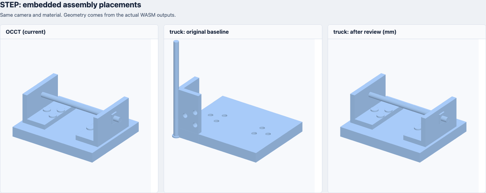
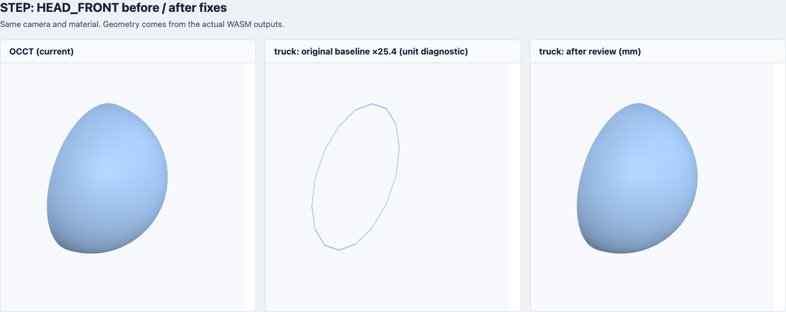

# Rust STEP 复查与上游 PR 准备

后续更新：曲面细化修复已将通过率提升到 **43/44**，见 [本轮修复与性能报告](rust-step-refined.zh-CN.md)。以下保留上一轮 40/44 的历史结果。

2026-10-30。在 [首次评测](rust-engine-evaluation.zh-CN.md) 和 [不显示修复](step-display-diagnosis.zh-CN.md) 后继续检查。所有解析、单位处理、装配与三角化仍在 Rust WASM 中执行，产品引擎尚未替换。

**44/44 含实体文件输出网格，几何筛查由最初 19/44、上一轮 21/44 提升到本轮 40/44，上一轮通过项没有回退。三份上游 PR 已发布，附英文描述和回归测试；仍有 4 个几何差异，另 11 个仅引用外部 STEP 的装配仍需要关联文件加载。**

## 本轮修复与优化

- 长度单位从文件中形状表示的上下文解析，覆盖毫米、厘米、米和转换单位；不把转换因子引用的毫米误当成整个文件单位。输入缺少单位、单位循环或无效、上下文混用单位时返回明确错误。
- 三角化容差先由 0.1 mm 换成源单位，装配完成后统一输出毫米。这样不会把 0.1 英寸当成 0.1 毫米；大部分残余差异由这一步解决。
- 正确接受可省略的装配描述。as1-tu-203.stp 从丢失装配、逐 shell 输出恢复到 18 个实例；边界与 OCCT 一致，面积误差 0.011%、体积误差 0.016%。
- 追踪无变换的形状表示关系以找到实体，去重并防止关系环；带变换的装配关系保留在装配图上。当前含实体样例中还有 0 个使用逐 shell 后备路径。
- 实体预览显式记录跳过的已知标注与线框；不把未知实体转换失败一律忽略。曲线兼容扫描改用借用参数，减少整份参数列表的复制。
- 拒绝非正/非有限容差及非有限输出坐标。上游补丁另补充了非有限曲线细分的快速失败保护。





## 已提交上游的三份 PR

见 [PR 交付说明](upstream/truck/README.zh-CN.md)，也可直接使用 [压缩包](upstream/truck-pr-ready.zip)。三份独立 PR 已发布到 ricosjp/truck 的 `master`，基线为提交 1ca3214e537004d466addbd85d6375807147a426。

| PR | 范围 | 回归测试 | 原代码失败数 |
| --- | --- | ---: | ---: |
| [#138](https://github.com/ricosjp/truck/pull/138) | 方向比例、VECTOR 长度、二维/三维坐标系、近乎平行的参考方向 | 9 | 8 |
| [#139](https://github.com/ricosjp/truck/pull/139) | 可省略的产品/装配 description 及 PartAttrs 映射 | 5 | 2 |
| [#140](https://github.com/ricosjp/truck/pull/140) | 非有限参数/采样误差触发的递归细分保护 | 6 | 4 |

三个 PR 均为 OPEN、非草稿且没有合并冲突；检查时 GitHub 尚无 CI 检查结果。[发布记录](upstream/truck/pull-requests.json) 保存了远程分支、提交与检查状态。

三份补丁均检查了独立应用和组合应用，20 个上游回归测试全部通过；实验核心另有 7 个单位和 3 个表示关系测试通过，共 30 个。先在原代码执行，确认这些测试能捕捉问题，再在补丁代码执行。

本地 Rust 1.93 无法构建 HEAD 的 parking_lot 0.13（要求 Rust 1.95），验证副本仅将 truck-topology 的 parking_lot / rclite 约束恢复到前一提交。**完整 HEAD 依赖图和整个上游测试集尚未验证。** 交付补丁没有依赖改动；[验证记录](upstream/truck/validation.json) 明确记录了该限制。PR 2 还有 String → Option<String> 的公开字段类型变化，需要维护者评估迁移。

40/44 的成绩还包含 Filens 实验适配层的单位、容差、表示关系遍历、预览筛选与 PCurve 兼容策略；三份上游补丁并不包含这些全部改动，不能把本轮语料成绩归给三份 PR 本身。

## 仍需修复

沿用前轮几何筛查阈值，没有放宽标准。每个 face 返回非空网格仍不足以证明实体完整。

| 文件 | 边界偏差 / 对角线 | 面积误差 | 有符号体积误差 | 双向表面 P95 最大值 mm |
| --- | ---: | ---: | ---: | ---: |
| cax-if/s1-c5-214/HEAD_BACK.stp | 28.07% | 33.25% | 97.31% | 46.160 |
| cax-if/s1-c5-214/TAIL_TURBINE.stp | 0.03% | 3.01% | 25.38% | 3.903 |
| cax-if/s1_pe_214/foot_front_prt.stp | 0.00% | 0.77% | 47.07% | 0.143 |
| cax-if/s1_pe_214/tail_turbine_prt.stp | 0.00% | 0.23% | 16.85% | 7.984 |

HEAD_BACK 的几何损失明显；两个涡轮样例仍有数毫米曲面差异。foot_front_prt 看起来接近、面积误差也小，但体积仍明显不同，不能当作已修复。具体根因尚未证明，需要进一步逐面核对裁剪、方向和实体有效性。

完整后续清单见 [remaining-issues.md](upstream/truck/remaining-issues.md)：还包括周期 PCurve 的有效参数区间/端点裁剪/绕回分支、缺失引用导致的不一致拓扑、混合单位装配、角度单位、外部关联 STEP 加载。预览中使用解析三维曲线的兼容策略不能直接当作通用上游几何修复。

## 体积与复现

| 引擎 | WASM KiB | gzip KiB | Brotli KiB |
| --- | ---: | ---: | ---: |
| 现有 OCCT | 2625.8 | 1020.2 | 797.0 |
| 本轮 Rust 实验适配器 | 921.8 | 324.5 | 253.1 |

同样使用 gzip 9、Brotli 11。Rust 候选的 Brotli 小 68.25%，但功能与几何能力仍未等价。该 WASM 使用原评测固定的 truck 版本和实验适配层；上游补丁在独立验证副本测试。没有把 JS 加载器/WASI 宿主体积计入引擎大小，也没有重新测量吞吐量或峰值内存。

```sh
node benchmarks/rust-engines/check-upstream-prs.mjs
node benchmarks/rust-engines/build.mjs --step-reviewed
node benchmarks/rust-engines/run.mjs --step-reviewed
node benchmarks/rust-engines/visualize.mjs --step-reviewed
node benchmarks/rust-engines/summarize-step-reviewed.mjs
```

新的 WASM、网格和 JSON 使用独立文件名，不覆盖前两轮结果。[完整语料、哈希与逐文件指标](assets/rust-engines/results-step-reviewed.json)。本轮仍是预览筛查，不是精确 CAD 等价验证。
