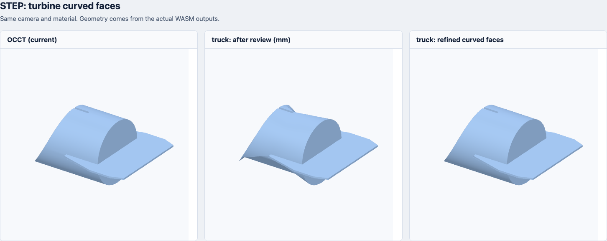
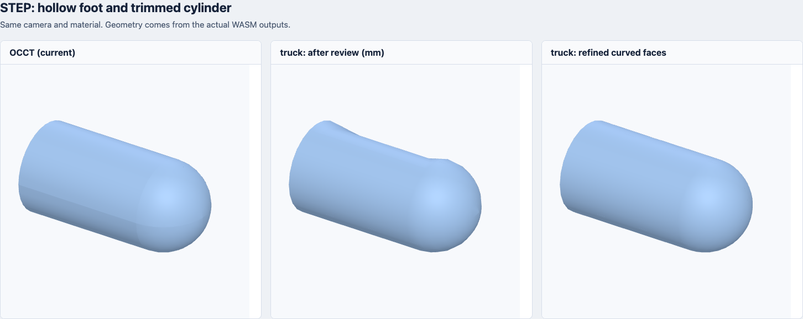

# Rust STEP 曲面细化修复

2026-10-30。继续修复 [上一轮复查](rust-step-pr-review.zh-CN.md) 的四个几何差异：**通过率从 40/44 提升到 43/44，原通过项无回退，44/44 含实体文件均输出网格且没有缺失 face。** 另外 11 个仅含外部引用的装配仍需要关联文件。本页保留实验版本的测量；后续已完成[浏览器接入、法线修复与独立候选包](rust-step-browser.zh-CN.md)，npm 发布等待其他改动。

## 修复内容

问题不只是容差太松：将四个失败样例的容差从 0.1 mm 收紧到 0.03 mm 后，四个仍失败。逐面检查发现，裁剪曲面的边界采样可以很密，但内部 Delaunay 三角形仍会横跨圆弧，形成穿过曲面的长弦。foot 的圆柱半径为 10 mm，某些三角形质心距轴只有约 7.43 mm；薄壳外观接近，体积误差却达到 47%。

本轮在 Rust 三角化核心中比较三角形的三维质心与参数曲面上的对应点，超过容差时在 UV 域插点并重新细化，保留裁剪约束边。优化后缓存顶点曲面求值，插入新顶点时复用已算过的质心；三角形缓存改用按 face 索引的数组，并校验顶点组合以处理 face 槽位复用。只有需要细化的三角形才查询裁剪区域，最终网格仍统一裁剪。每个 face 最多额外细化 64 轮、增加 100,000 个顶点；达到预算返回当前近似，非有限误差立即失败。**这是有界的采样改进，不保证任意曲面上的最大误差都小于容差。**

同时修复了新增采样暴露出的球面问题：STEP 球面的经纬度搜索提示需转换到内核参数系；反向 Processor 交换参数轴时也应交换输入提示；极点最近参数搜索保留有限经度；为上一个退化点补 UV 时，使用上一个点的三维位置。修复后 `HEAD_FRONT` 继续通过筛查，包围盒误差 0.027%，表面 P95 为 0.0705 mm。

## 几何结果

所有结果使用原筛查阈值：缺失 face 为 0、包围盒相对误差 <1%、面积误差 <3%、有符号体积误差 <5%，双向采样表面 P95 ≤ max(0.2 mm, 参考对角线 ×0.001)。没有放宽标准。

| 文件 | 体积误差：之前 → 修复后 | 表面 P95：之前 → 修复后（mm） | 结果 |
| --- | ---: | ---: | --- |
| `s1-c5-214/TAIL_TURBINE.stp` | 25.381% → 0.134% | 3.903 → 0.086 | 通过 |
| `s1_pe_214/foot_front_prt.stp` | 47.072% → 0.926% | 0.143 → 0.064 | 通过 |
| `s1_pe_214/tail_turbine_prt.stp` | 16.855% → 0.031% | 7.984 → 0.085 | 通过 |

路径均位于语料的 `cax-if/` 下。P95 取两个采样方向的较大值，不是精确 Hausdorff 距离。





图片三列依次为 OCCT、上一轮 Rust、本轮 Rust，使用相同相机和材质。foot 的外观变化较小，体积检查才能发现薄壳内部的明显差异。

## 体积与耗时

| 引擎 | WASM KiB | gzip KiB | Brotli KiB |
| --- | ---: | ---: | ---: |
| 现有 OCCT | 2625.76 | 1020.16 | 797.05 |
| 上一轮 Rust | 921.83 | 324.54 | 253.06 |
| 曲面细化初版 | 924.57 | 326.46 | 254.26 |
| 优化后 Rust | 924.79 | 326.16 | 254.85 |

使用同样的 opt-level=z、LTO、Binaryen 131 -Oz、gzip 9 和 Brotli 11；构建时映射本机路径。优化后 Brotli 为 260,971 字节，比上一轮 Rust 增加 1,836 字节，比曲面细化初版增加 610 字节（约 0.60 KiB），比现有 OCCT 小约 68.0%。未计入 JS 加载器和 WASI 宿主体积，几何能力仍未完全等价。

对相同 44 个文件连续测量三轮，每个文件和每轮轮换执行上一轮 Rust、曲面细化初版和优化后版本。每轮合计网格生成耗时的中位数分别为 **2.514 秒、3.310 秒、2.924 秒**。本次优化使细化版耗时下降 **11.7%**；相对上一轮 Rust 的额外耗时从 31.7% 降至 **16.3%**。

三轮中还逐一核对了优化前后的三角形内容：忽略装配实例和三角形的输出顺序，所有坐标、法线、顶点顺序与朝向均精确一致，没有数值取整。三角形总数保持 380,328；相对修复前的 298,243 增加 27.5%。精度收益仍需要更多三角形，缓存优化减少了重复计算。

耗时包括三角化、网格合并和装配变换，不包含解析、WASM 编译/启动和序列化；未测浏览器端到端耗时及峰值内存。[逐轮记录与几何内容哈希](assets/rust-engines/timing-step-refined.json)。

## 尚未解决的 HEAD_BACK

`cax-if/s1-c5-214/HEAD_BACK.stp` 仍失败：包围盒相对误差 28.07%、面积误差 33.11%、有符号体积误差 97.31%，表面 P95 为 46.160 mm。

逐面核对发现，OCCT 的 #314 球面选出了与 Rust 不同的区域：整体 x 最大值约 310 mm，而 Rust 约 250 mm；多个面的朝向也不同。官方未裁剪的 occt-import-js 0.0.23 与产品版 OCCT 在这四个原失败样例上的包围盒、面积和体积一致，已排除产品裁剪版造成参考差异，见 [交叉核对记录](assets/rust-engines/reference-crosscheck-step-refined.json)。两个版本共用导入器，这仍不能证明任一方正确，后续需独立核对球面裁剪区域与闭壳朝向。本轮保留失败项，没有根据参考结果强行翻面或补半球。

## 补丁与复现

[第 4 份补丁](upstream/truck/0004-refine-trimmed-surfaces-and-poles.patch)、[英文 PR 草案](upstream/truck/pr-4-trimmed-surfaces.md) 和 [验证记录](upstream/truck/validation-refined.json) 已更新，**已提交 [上游 PR #141](https://github.com/ricosjp/truck/pull/141)**；之前的三个 PR 保持不变。

新增 8 项合成回归测试，原代码 7 项失败、1 项通过，修复后 8 项全部通过。补丁检查过可独立应用到上游 `1ca3214e537004d466addbd85d6375807147a426`。实际构建使用固定基线 `78d699b0792b39e27c2bf073b682986701644e91`、Rust 1.93 和锁定依赖，无依赖兼容覆盖；四个修改源码文件在两个未打补丁的基线间完全相同。尚未验证较新上游的完整依赖图或整个上游测试集。

43/44 的成绩仍依赖 Filens 原有的单位/容差处理、装配表示关系遍历和曲线兼容适配，不能归因于这份补丁本身。解析和三角化全部位于前端 Rust/WASM 核心。

先按 [首次评测](rust-engine-evaluation.zh-CN.md) 准备语料、工具和依赖缓存，然后在 Filens 工作区执行：

```sh
node benchmarks/rust-engines/build-step-refined.mjs --test
node benchmarks/rust-engines/run.mjs --step-refined
node benchmarks/rust-engines/benchmark-step-refined.mjs
node benchmarks/rust-engines/visualize.mjs --step-refined
node benchmarks/rust-engines/summarize-step-refined.mjs
```

构建脚本从干净固定基线应用第 4 份补丁，锁定 Cargo 依赖，记录补丁、适配源码和锁文件哈希；几何输出使用单独目录，不覆盖历史结果。汇总脚本读取本轮归档的 [原代码失败日志](upstream/truck/regressions-refined-before.txt)，核对补丁后测试日志与前三份补丁的原始哈希；不会重新运行原代码。[完整语料哈希与逐文件指标](assets/rust-engines/results-step-refined.json)。筛查用于预览质量判断，不是精确 CAD 等价证明。

本次另保留了优化前的 WASM、构建信息和结果，使用 `benchmark-step-refined.mjs --compare-preopt` 同时测量三个版本，并校验优化前后几何内容。默认命令测量上一轮 Rust 与当前候选两个版本；优化前的临时归档不作为构建依赖。
