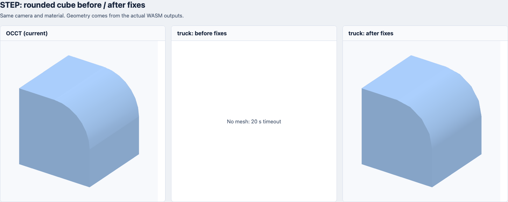
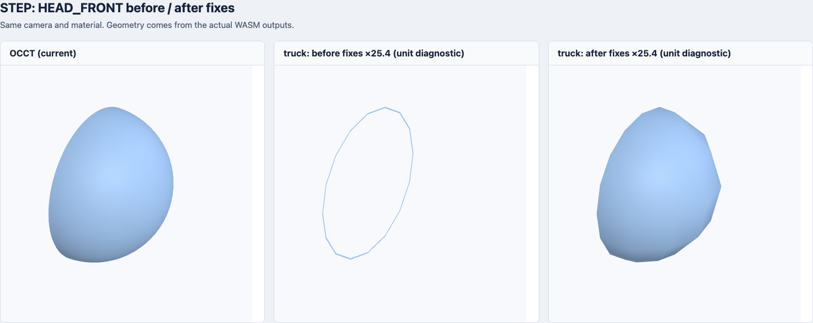

# STEP 不显示问题排查与修复实验

2026-10-29。同一批 55 个 STEP、同一 OCCT 参考、实际执行 Rust WASM。原始结果保留在 [初次评测](rust-engine-evaluation.zh-CN.md)，本页记录后续兼容性修复；产品仍使用 OCCT。

**Rust 原先额外失败的 7 个文件全部恢复非空网格：37/44 → 44/44。几何筛查从 19/44 → 21/44，原先通过的 19 个无回退。能输出网格不代表几何等价，仍不能据此替换产品引擎。**

## 原有 OCCT 的 11 个空结果

这 11 个 STEP 自身没有实体 shell，而通过 DOCUMENT_FILE / 外部引用记录指向其他 STEP 零件。当前单文件、单 buffer 导入没有解析并加载这些兄弟文件，因此没有网格可画。

例如 FOOT.stp 的 #33 / #73 分别引用 FOOT_FRONT_000.stp 和 FOOT_BACK_000.stp；foot_asm.stp 的 #84 / #155 分别引用 foot_back_prt.stp 和 foot_front_prt.stp。单独导入被引用的零件文件，OCCT 有几何输出。

- `cax-if/s1-c5-214/FOOT.stp`
- `cax-if/s1-c5-214/HEAD.stp`
- `cax-if/s1-c5-214/MAINBODY.stp`
- `cax-if/s1-c5-214/TAIL.stp`
- `cax-if/s1-c5-214/s1-c5-214.stp`
- `cax-if/s1-tu-203/s1-tu-203.stp`
- `cax-if/s1_pe_214/foot_asm.stp`
- `cax-if/s1_pe_214/head_asm.stp`
- `cax-if/s1_pe_214/mainbody_asm.stp`
- `cax-if/s1_pe_214/s1_pe_214.stp`
- `cax-if/s1_pe_214/tail_asm.stp`

完整显示这些装配需要提供关联文件、按引用解析并保留装配变换，或从 CAD 软件导出包含所有实体的单文件 STEP。仅更换 C++ / Rust 语言不会补齐外部文件。此次未实现多文件装配加载；其中 s1-c5-214.stp 还触发 ruststep 语法解析错误，不能把“没有内嵌实体”理解为其所有语法都已被支持。

## Rust 额外失败的 7 个文件

| 文件 | 已定位原因 | 修复后三角形 | 未生成网格的面 | 几何筛查 |
| --- | --- | ---: | ---: | --- |
| cax-if/io1-cm-214.stp | 形状列表混有文字 / 标注 | 1304 | 0 | 通过 |
| cax-if/s1-c5-214/FOOT_BACK_000.stp | 方向未归一化；缺省参考轴可与主轴平行 | 81 | 0 | 仍有差异 |
| cax-if/s1-c5-214/FOOT_FRONT_000.stp | 方向未归一化；缺省参考轴可与主轴平行 | 81 | 0 | 仍有差异 |
| cax-if/s1-c5-214/HEAD_BACK.stp | 方向未归一化；缺省参考轴可与主轴平行 | 212 | 1 | 仍有差异 |
| cax-if/s1-c5-214/MAINBODY_BACK.stp | 方向未归一化；缺省参考轴可与主轴平行 | 794 | 0 | 仍有差异 |
| cax-if/s1-c5-214/MAINBODY_FRONT.stp | 方向未归一化；缺省参考轴可与主轴平行 | 624 | 0 | 仍有差异 |
| rounded-cube/rounded-cube.step | 周期 PCurve 参数范围 / 角度分支 | 28 | 0 | 通过 |

方向修复遵循 STEP 的方向比例语义：非单位向量先归一化；AXIS2_PLACEMENT_3D 没有参考方向、主轴又平行 X 时，选择 Y 作参考。原先圆弧变换矩阵奇异，边转换失败，随后空边界索引触发 WASM trap。修复在 Rust WASM 内完成。

io1-cm-214.stp 的 shape_representation.items 混有文字 / 标注，truck 装配导入把它们都当作实体形状而失败。现在只跳过已识别的文字 / 标注引用，保留几何实体；结果记录跳过 9 条引用。这是实体预览适配，尚未实现标注渲染。

rounded-cube.step 卡在第 8 条边：首选 PCurve 的非夹持周期 NURBS 被使用整个 knot 范围 [-2.0944, 8.3776]，有效基础参数区间应为 [0, 6.2832]，两端求值得到 NaN；细分程序深度上限为 100，NaN 比较无法满足误差终止条件，形成极大的递归展开。另外一条圆柱上的 PCurve 反算端点后丢失角度分支，把 90° 圆弧连成了 270°。

针对这两类情况，使用 STEP 同时提供的三维解析曲线，并由边端点裁剪。没有将所有曲线强制改成三维表示。圆角立方体现为 7/7 个面、28 个三角形；与 OCCT 比较，面积误差 0.18%、体积误差 0.36%，双向表面距离 P95 最大 0.094 mm，通过本次筛查。



HEAD_FRONT.stp 也从 5 个面中缺 4 个恢复到 5/5 个面都有网格。下图两份 truck 输出都额外乘 25.4，便于单独观察缺面；单位转换还没有加入候选。



## 复测边界与体积

仍有 **23/44** 个非空文件未通过几何筛查，涉及单位、源单位下过粗的三角化容差、装配位置及曲面兼容。HEAD_BACK.stp 有 1 个 face 返回空三角网格，此次诊断将这种 Some(empty) 也计为缺面，避免只看返回值存在就算成功。

筛查沿用初次评测：缺面数为 0；边界偏差 < 对角线 1%；面积误差 <3%；体积误差 <5%；双向采样表面距离 P95 ≤ max(0.2 mm, 对角线 0.1%)。两端请求容差 0.1，但 truck 仍使用源坐标，OCCT 输出毫米。原 19 个通过项在更严格的空面计数下也全部通过。

| 引擎 | WASM KiB | gzip KiB | Brotli KiB |
| --- | ---: | ---: | ---: |
| 现有 OCCT | 2625.8 | 1020.2 | 797.0 |
| 原始 truck 适配器 | 879.8 | 305.5 | 238.4 |
| 修复后 truck 适配器 | 901.5 | 316.2 | 246.8 |

同样使用 gzip 9、Brotli 11。修复后 Brotli 比现有 OCCT 小 **69.03%**，比原始适配器增加 8.4 KiB。体积包含预处理和诊断代码；能力范围尚不等价，不能只看下载体积决定替换。

## 复现

依赖准备、编译设置与源版本见初次评测。原始适配器保存在 src/step_baseline.rs，修复版在 src/step.rs / src/step_prepare.rs，第三方源码未修改。

```sh
node benchmarks/rust-engines/build.mjs --truck-fixed
node benchmarks/rust-engines/run.mjs --truck-fixed
node benchmarks/rust-engines/visualize.mjs --step-fixed
node benchmarks/rust-engines/summarize-step-fixed.mjs
```

--truck-fixed 使用单独的 WASM、网格目录和 JSON，不覆盖原始基线。--trace 可逐边 / 逐面定位；--prefer-3d 是额外的全局切换诊断开关，本次全量结果未启用。解析、语义修复、三角化都在 Rust WASM 中执行；Node 负责调用、指标比较与截图；没有添加 Go 格式转换逻辑，也没有接入产品转换链路。

[完整复测 JSON 与 SHA-256](assets/rust-engines/results-step-fixed.json)。耗时为单次冷运行诊断值，不构成性能评测。

<details><summary>55 个文件修复前后</summary>

| 文件 | 原始 truck 三角形 | 修复后 truck 三角形 | 修复后缺面 | 筛查 |
| --- | ---: | ---: | ---: | --- |
| cax-if/as1-oc-214.stp | 28716 | 28716 | 0 | 通过 |
| cax-if/as1-oc-214/as1-oc-214.stp | 28716 | 28716 | 0 | 通过 |
| cax-if/as1-tu-203.stp | 15280 | 15280 | 0 | 仍有几何 / 单位 / 装配差异 |
| cax-if/as1_pe_203.stp | 992 | 992 | 0 | 仍有几何 / 单位 / 装配差异 |
| cax-if/dm1-id-214.stp | 586 | 586 | 0 | 仍有几何 / 单位 / 装配差异 |
| cax-if/dm1-oc-214.stp | 8988 | 8988 | 0 | 通过 |
| cax-if/dm1-pe-214.stp | 952 | 952 | 0 | 仍有几何 / 单位 / 装配差异 |
| cax-if/io1-cm-214.stp | 无网格 / 错误 | 1304 | 0 | 通过 |
| cax-if/io1-tu-203.stp | 4912 | 4912 | 0 | 通过 |
| cax-if/s1-c5-214/FOOT.stp | 无网格 / 错误 | 无内嵌几何 | — | 仅外部引用 |
| cax-if/s1-c5-214/FOOT_BACK_000.stp | 无网格 / 错误 | 81 | 0 | 仍有几何 / 单位 / 装配差异 |
| cax-if/s1-c5-214/FOOT_FRONT_000.stp | 无网格 / 错误 | 81 | 0 | 仍有几何 / 单位 / 装配差异 |
| cax-if/s1-c5-214/HEAD.stp | 无网格 / 错误 | 无内嵌几何 | — | 仅外部引用 |
| cax-if/s1-c5-214/HEAD_BACK.stp | 无网格 / 错误 | 212 | 1 | 仍有几何 / 单位 / 装配差异 |
| cax-if/s1-c5-214/HEAD_FRONT.stp | 32 | 169 | 0 | 仍有几何 / 单位 / 装配差异 |
| cax-if/s1-c5-214/MAINBODY.stp | 无网格 / 错误 | 无内嵌几何 | — | 仅外部引用 |
| cax-if/s1-c5-214/MAINBODY_BACK.stp | 无网格 / 错误 | 794 | 0 | 仍有几何 / 单位 / 装配差异 |
| cax-if/s1-c5-214/MAINBODY_FRONT.stp | 无网格 / 错误 | 624 | 0 | 仍有几何 / 单位 / 装配差异 |
| cax-if/s1-c5-214/TAIL.stp | 无网格 / 错误 | 无内嵌几何 | — | 仅外部引用 |
| cax-if/s1-c5-214/TAIL_MIDDLE_PART.stp | 57 | 92 | 0 | 仍有几何 / 单位 / 装配差异 |
| cax-if/s1-c5-214/TAIL_TURBINE.stp | 94 | 90 | 0 | 仍有几何 / 单位 / 装配差异 |
| cax-if/s1-c5-214/s1-c5-214.stp | 无网格 / 错误 | 无内嵌几何 | — | 仅外部引用 |
| cax-if/s1-tu-203/footback.stp | 3588 | 3588 | 0 | 通过 |
| cax-if/s1-tu-203/footfront.stp | 3499 | 3499 | 0 | 通过 |
| cax-if/s1-tu-203/headback.stp | 13500 | 13500 | 0 | 通过 |
| cax-if/s1-tu-203/headfront.stp | 9427 | 9427 | 0 | 通过 |
| cax-if/s1-tu-203/mainbodyback.stp | 22680 | 22680 | 0 | 通过 |
| cax-if/s1-tu-203/mainbodyfront.stp | 22264 | 22264 | 0 | 通过 |
| cax-if/s1-tu-203/s1-tu-203.stp | 无网格 / 错误 | 无内嵌几何 | — | 仅外部引用 |
| cax-if/s1-tu-203/tailmiddlepart.stp | 352 | 352 | 0 | 通过 |
| cax-if/s1-tu-203/tailturbine.stp | 3592 | 3592 | 0 | 通过 |
| cax-if/s1_pe_214/foot_asm.stp | 无网格 / 错误 | 无内嵌几何 | — | 仅外部引用 |
| cax-if/s1_pe_214/foot_back_prt.stp | 103 | 103 | 0 | 仍有几何 / 单位 / 装配差异 |
| cax-if/s1_pe_214/foot_front_prt.stp | 119 | 119 | 0 | 仍有几何 / 单位 / 装配差异 |
| cax-if/s1_pe_214/head_asm.stp | 无网格 / 错误 | 无内嵌几何 | — | 仅外部引用 |
| cax-if/s1_pe_214/head_back_prt.stp | 417 | 417 | 0 | 仍有几何 / 单位 / 装配差异 |
| cax-if/s1_pe_214/head_front_prt.stp | 365 | 365 | 0 | 仍有几何 / 单位 / 装配差异 |
| cax-if/s1_pe_214/main_body_back_prt.stp | 1436 | 1436 | 0 | 仍有几何 / 单位 / 装配差异 |
| cax-if/s1_pe_214/main_body_front_prt.stp | 1716 | 1716 | 0 | 仍有几何 / 单位 / 装配差异 |
| cax-if/s1_pe_214/mainbody_asm.stp | 无网格 / 错误 | 无内嵌几何 | — | 仅外部引用 |
| cax-if/s1_pe_214/s1_pe_214.stp | 无网格 / 错误 | 无内嵌几何 | — | 仅外部引用 |
| cax-if/s1_pe_214/tail_asm.stp | 无网格 / 错误 | 无内嵌几何 | — | 仅外部引用 |
| cax-if/s1_pe_214/tail_middle_part_prt.stp | 132 | 132 | 0 | 仍有几何 / 单位 / 装配差异 |
| cax-if/s1_pe_214/tail_turbine_prt.stp | 122 | 122 | 0 | 仍有几何 / 单位 / 装配差异 |
| cax-if/sg1-c5-214.stp | 696 | 696 | 0 | 通过 |
| conical-surface/conical-surface.step | 50 | 50 | 0 | 仍有几何 / 单位 / 装配差异 |
| cube-10x10mm/Cube 10x10.stp | 12 | 12 | 0 | 通过 |
| cube-fcstd/cube.step | 12 | 12 | 0 | 通过 |
| cube-fcstd/cube2.step | 12 | 12 | 0 | 通过 |
| cube-fcstd/cube3.step | 12 | 12 | 0 | 通过 |
| cube-units/cube-in.step | 12 | 12 | 0 | 仍有几何 / 单位 / 装配差异 |
| cube-units/cube-m.step | 12 | 12 | 0 | 仍有几何 / 单位 / 装配差异 |
| cube-units/cube-mm.step | 12 | 12 | 0 | 通过 |
| rounded-cube/rounded-cube.step | 超时 | 28 | 0 | 通过 |
| simple-basic-cube/cube.stp | 12 | 12 | 0 | 通过 |

</details>
